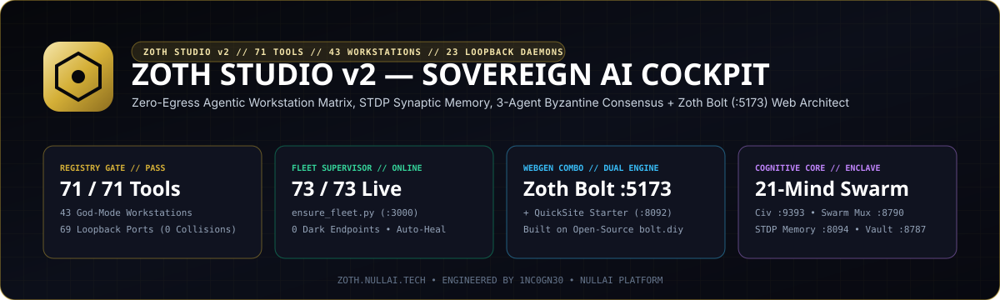
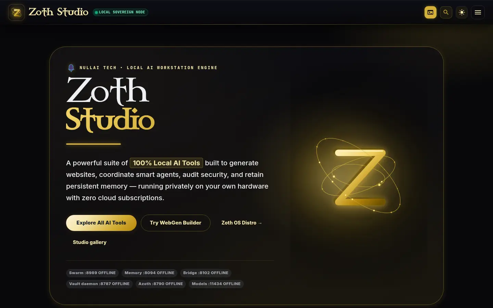
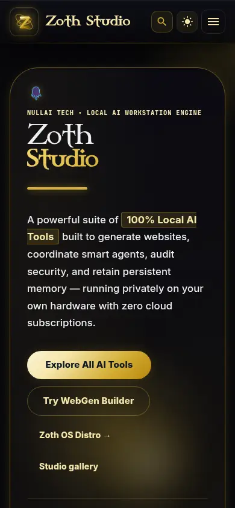
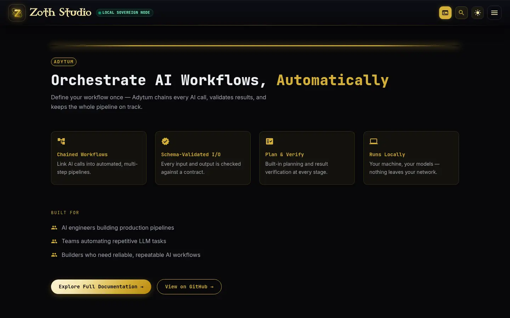
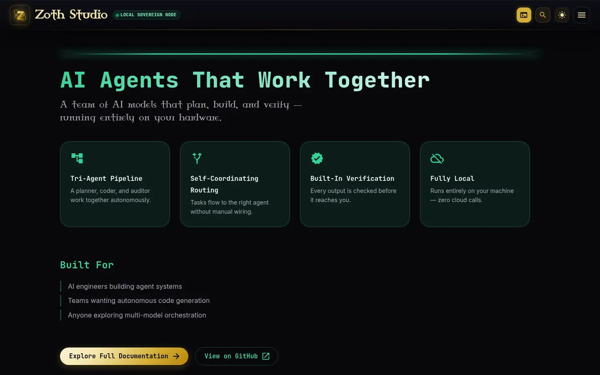
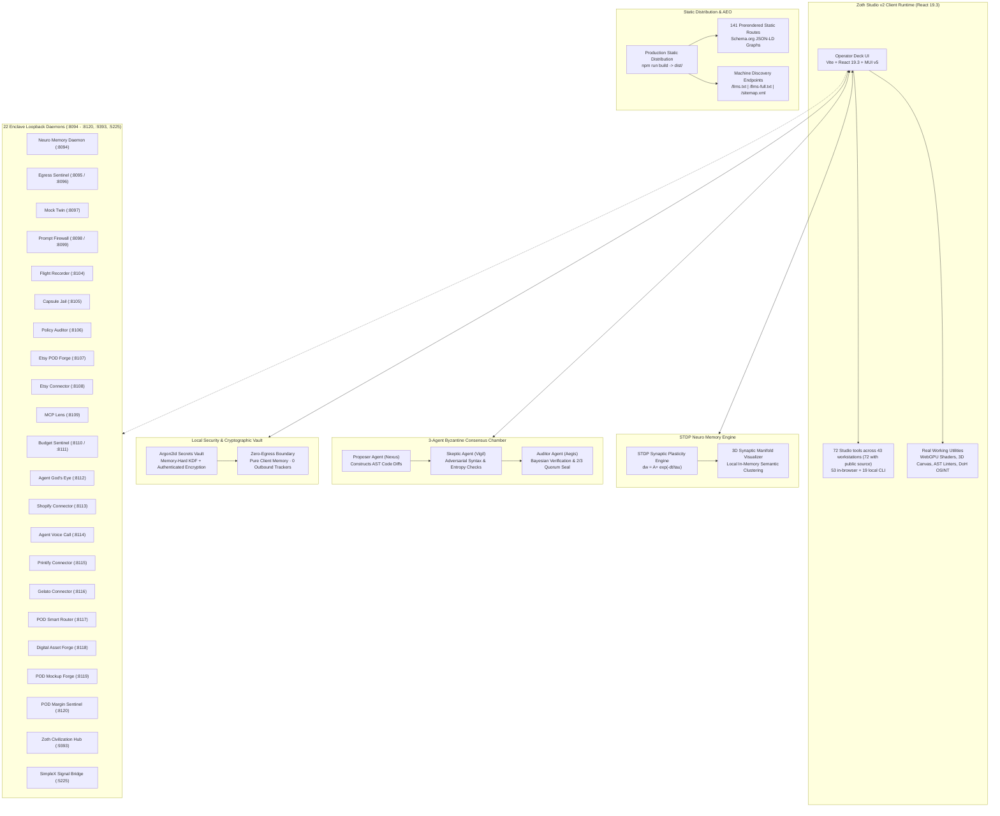

<div align="center">
  
</div>

<br />

# Zoth Studio v2

> **Zero-Egress Sovereign Agent Development Studio, Workstation Cockpit & 72-Tool Matrix**  
> *Client-side WebGPU acceleration, biomorphic STDP memory, 100% workstation coverage across all 72 ecosystem tools, 17 live supervised fleet daemons (`ensure_fleet.py`), Vaelor L1 DAG Blockchain (`:8140`), ZothOS v3.4.0 + ZothOS-Lite v1.1 (`:8145`), Zoth Civilization 3D (`:9393`), Zoth Bolt (`:5173`), 60fps Unicode `U+2800` Braille + Ordered Bayer 8×8 Dither Route Intros, Editorial Light/Dark Dual Theme (`#FAF8F3` Alabaster + `#070709` Void), 3-agent Byzantine consensus, and Argon2id cryptographic vault.*

[](#zero-egress-security-invariants)
[](#netlify-deployment-instructions)
[](#100-dedicated-interactive-workstation-coverage)
[](#100-dedicated-interactive-workstation-coverage)
[](https://vitejs.dev)
[](https://react.dev)
[](https://mui.com)
[](#webgpu--wasm-acceleration)
[](#system-overview--core-philosophy)
[](LICENSE)

---

## ⬇️ Download Zoth Studio v2.2.0 (macOS, Windows & Linux Binaries)

All official cross-platform desktop bundles and standalone native executables are published on the [**GitHub Releases page (`v2.2.0`)**](https://github.com/NullAITech/zoth-studio-v2/releases/tag/v2.2.0) and verified by [`SHA256SUMS.txt`](https://github.com/NullAITech/zoth-studio-v2/releases/download/v2.2.0/SHA256SUMS.txt):

| Platform | Architecture | Package / Binary | Direct Download |
| :--- | :--- | :--- | :--- |
| **🍎 macOS** | Universal (`arm64` Apple Silicon + `x86_64` Intel) | **`Zoth Studio.app` Bundle (`.zip`)** | [`Zoth_Studio-v2.2.0-macOS-universal.zip`](https://github.com/NullAITech/zoth-studio-v2/releases/download/v2.2.0/Zoth_Studio-v2.2.0-macOS-universal.zip) |
| **🍎 macOS** | Universal (`arm64` + `x86_64`) | **Portable Tarball (`.tar.gz`)** | [`zoth-studio-v2.2.0-macos-universal.tar.gz`](https://github.com/NullAITech/zoth-studio-v2/releases/download/v2.2.0/zoth-studio-v2.2.0-macos-universal.tar.gz) |
| **🍎 macOS** | Apple Silicon (`M1/M2/M3/M4`) | **Native Mach-O Binary** | [`ZothStudio-macos-arm64`](https://github.com/NullAITech/zoth-studio-v2/releases/download/v2.2.0/ZothStudio-macos-arm64) |
| **🍎 macOS** | Intel (`x86_64`) | **Native Mach-O Binary** | [`ZothStudio-macos-x86_64`](https://github.com/NullAITech/zoth-studio-v2/releases/download/v2.2.0/ZothStudio-macos-x86_64) |
| **🪟 Windows** | Windows 10 / 11 (`x86_64`) | **Single-File Self-Extracting `.exe` Setup** | [`Zoth_Studio-v2.2.0-windows-x86_64-setup.exe`](https://github.com/NullAITech/zoth-studio-v2/releases/download/v2.2.0/Zoth_Studio-v2.2.0-windows-x86_64-setup.exe) |
| **🪟 Windows** | Windows 10 / 11 (`x86_64`) | **Portable Windows Archive (`.zip`)** | [`zoth-studio-v2.2.0-windows-x86_64.zip`](https://github.com/NullAITech/zoth-studio-v2/releases/download/v2.2.0/zoth-studio-v2.2.0-windows-x86_64.zip) |
| **🪟 Windows** | Windows 10 / 11 (`x86_64`) | **Native PE64 Executable (`.exe`)** | [`ZothStudio-windows-x86_64.exe`](https://github.com/NullAITech/zoth-studio-v2/releases/download/v2.2.0/ZothStudio-windows-x86_64.exe) |
| **🐧 Linux** | Debian / Ubuntu / ZothOS / Kali (`amd64`) | **Debian Package (`.deb`)** | [`zoth-studio_2.1.0_amd64.deb`](https://github.com/NullAITech/zoth-studio-v2/releases/download/v2.2.0/zoth-studio_2.1.0_amd64.deb) |
| **🐧 Linux** | Universal Linux (`x86_64`) | **AppImage (`.AppImage`)** | [`Zoth_Studio-v2.2.0-x86_64.AppImage`](https://github.com/NullAITech/zoth-studio-v2/releases/download/v2.2.0/Zoth_Studio-v2.2.0-x86_64.AppImage) |
| **🐧 Linux** | Universal Linux (`x86_64`) | **Self-Extracting Installer (`.run`)** | [`zoth-studio-v2.2.0-linux-x86_64.run`](https://github.com/NullAITech/zoth-studio-v2/releases/download/v2.2.0/zoth-studio-v2.2.0-linux-x86_64.run) |
| **🐧 Linux** | Universal Linux (`x86_64`) | **Portable Tarball (`.tar.gz`)** | [`zoth-studio-v2.2.0-linux-x86_64.tar.gz`](https://github.com/NullAITech/zoth-studio-v2/releases/download/v2.2.0/zoth-studio-v2.2.0-linux-x86_64.tar.gz) |
| **🐧 Linux** | Universal Linux (`x86_64`) | **Native ELF64 Binary** | [`zoth-studio-linux-x86_64`](https://github.com/NullAITech/zoth-studio-v2/releases/download/v2.2.0/zoth-studio-linux-x86_64) |

---

## Visual Gallery & Studio Tour

Desktop and mobile captures, plus screen recordings of each route intro motion design, live on [/gallery](https://zoth.nullai.tech/gallery). Captures are preserved in [`public/studio-captures/`](public/studio-captures).

<p>
  
  
</p>
<p>
  
  
</p>

| Page | Route | Desktop | Mobile | Intro Motion |
| :--- | :--- | :--- | :--- | :--- |
| **Home** | `/` | [shot](public/studio-captures/home-desktop.webp) | [shot](public/studio-captures/home-mobile.webp) | [video](public/studio-captures/home-intro-desktop.mp4) |
| **Adytum** | `/adytum` | [shot](public/studio-captures/adytum-desktop.webp) | [shot](public/studio-captures/adytum-mobile.webp) | [video](public/studio-captures/adytum-intro-desktop.mp4) |
| **Memory** | `/memory` | [shot](public/studio-captures/memory-desktop.webp) | [shot](public/studio-captures/memory-mobile.webp) | [video](public/studio-captures/memory-intro-desktop.mp4) |
| **Swarm** | `/swarm` | [shot](public/studio-captures/swarm-desktop.webp) | [shot](public/studio-captures/swarm-mobile.webp) | [video](public/studio-captures/swarm-intro-desktop.mp4) |
| **Tools Matrix** | `/tools` | [shot](public/studio-captures/tools-desktop.webp) | [shot](public/studio-captures/tools-mobile.webp) | [video](public/studio-captures/tools-intro-desktop.mp4) |
| **Workstations** | `/workstations` | [shot](public/studio-captures/workstations-desktop.webp) | [shot](public/studio-captures/workstations-mobile.webp) | [video](public/studio-captures/workstations-intro-desktop.mp4) |
| **Consensus** | `/consensus` | [shot](public/studio-captures/consensus-desktop.webp) | [shot](public/studio-captures/consensus-mobile.webp) | [video](public/studio-captures/consensus-intro-desktop.mp4) |
| **WebGen** | `/webgen` | [shot](public/studio-captures/webgen-desktop.webp) | [shot](public/studio-captures/webgen-mobile.webp) | [video](public/studio-captures/webgen-intro-desktop.mp4) |
| **HexStrike** | `/hexstrike` | [shot](public/studio-captures/hexstrike-desktop.webp) | [shot](public/studio-captures/hexstrike-mobile.webp) | [video](public/studio-captures/hexstrike-intro-desktop.mp4) |
| **Zoth OS** | `/zoth-os` | [shot](public/studio-captures/zoth-os-desktop.webp) | [shot](public/studio-captures/zoth-os-mobile.webp) | [video](public/studio-captures/zoth-os-intro-desktop.mp4) |
| **Civilization** | `/civilization` | [shot](public/studio-captures/home-desktop.webp) | [shot](public/studio-captures/home-mobile.webp) | Live SSE Engine (`:9393`) |

---

## System Overview & Core Philosophy

**Zoth Studio v2** is a zero-egress, sovereign developer studio designed for orchestrating autonomous AI agent workflows, inspecting code syntax, executing hardware-accelerated WebGPU compute shaders, and interfacing with local model foundries (such as Ollama or llama.cpp). Built with **React 19.3** and a gold-on-void aesthetic (`#D4AF37` on `#08080B`), Zoth Studio v2 unifies **72 dedicated interactive tool workstations**, 141 prerendered static routes, and the WebMCP (Model Context Protocol) tool suite directly in the browser.

- **WHAT THIS IS**: A client-side developer workstation and local tool catalog for coordinating autonomous agent workflows, running WebGPU tensor calculations, visualizing biomorphic STDP synaptic memories, executing 3-agent Byzantine consensus simulations, and connecting to local models on local silicon.
- **WHAT THIS IS NOT**: This is not a cloud SaaS, does not send prompts or telemetry to remote endpoints, and does not require third-party accounts. All primary tools run client-side in the browser, with optional local CLI daemons for IPC and local storage.
- **WINDOWCAROUSEL ARCHITECTURE**: Zoth Studio v2 implements an adaptive `WindowCarousel` architecture across tool suites (WebGen, Memory, Swarms). Operators can glide through full-detail interface cards with generous breathing room or toggle into a clean, stacked single-column view with a single click.

---

## Architectural Topology

### ASCII System Topology

```
+====================================================================================================+
|                                    ZOTH STUDIO v2 OPERATOR WORKSTATION                              |
|                       Client-Side Browser Runtime (React 19.3 + MUI v5 Gold-on-Void)                |
+====================================================================================================+
        |                                     |                                     |
        v                                     v                                     v
+-------------------------------+  +-------------------------------+  +-------------------------------+
|     72 DEDICATED WORKSTATIONS |  |  22 ENCLAVE LOOPBACK DAEMONS  |  |      STDP NEURO MEMORY        |
|  - In-Browser God Mode Engines|  |  - Ports 8094-8120, 9393, 5225|  |  - Hebbian LTP / LTD Learning |
|  - 72 Tools (72 public repos) |  |  - Zero-Cloud SNI Proxy       |  |  - 3D Synaptic Manifold       |
|  - 100% Native Tool Coverage  |  |  - Full Forensics Flight Rec  |  |  - Exponential Weight Decay   |
|  - Real Client Utility        |  |  - Multi-Channel POD Routers  |  |  - Local Vector Clustering    |
|  - Zero Broken Dependencies   |  |  - Planetary Recon Radar      |  |  - Pure Client Memory State   |
+-------------------------------+  +-------------------------------+  +-------------------------------+
        |                                     |                                     |
        +-------------------------------------+-------------------------------------+
                                              |
        +-------------------------------------+-------------------------------------+
        |                                     |                                     |
        v                                     v                                     v
+-------------------------------+  +-------------------------------+  +-------------------------------+
|  3-AGENT BYZANTINE CONSENSUS  |  |    ARGON2id SECRETS VAULT     |  |     ZERO-EGRESS GUARANTEE     |
|  - Proposer Agent (AST Diff)  |  |  - Client WebCrypto Enclave   |  |  - 100% Client-Side Execution |
|  - Skeptic Agent (Evaluation) |  |  - Memory-Hard Argon2id KDF   |  |  - Zero Cloud Telemetry       |
|  - Auditor Agent (Synthesis)  |  |  - Authenticated AEAD Cipher  |  |  - No Remote Analytics Trackers|
|  - 2/3 Supermajority Seal     |  |  - Local Key Zeroization      |  |  - Offline-Capable            |
+-------------------------------+  +-------------------------------+  +-------------------------------+
        |                                     |                                     |
        v                                     v                                     v
+-------------------------------+  +-------------------------------+  +-------------------------------+
|  VAELOR L1 & ZOTHOS-LITE      |  |    NETLIFY STATIC HOSTING     |  |   AEO / AX MACHINE DISCOVERY  |
|  - Vaelor DAG L1 (:8140)      |  |  - 141 Prerendered Routes     |  |  - /llms.txt & /llms-full.txt |
|  - ZothOS-Lite GUI (:8145)    |  |  - Instant FCP (< 200ms)      |  |  - /ai.txt Crawler Policy     |
|  - ZothOS v3.4.0 ISO Ready    |  |  - Strict CSP & Security      |  |  - /sitemap.xml (141 Entries) |
|  - 100% Free & Open Access    |  |  - Immutable Asset Caching    |  |  - Schema.org JSON-LD Graphs  |
+-------------------------------+  +-------------------------------+  +-------------------------------+
```

### Mermaid Architecture Topology



---

## 3D Netrunner Cyber-Cortex & 7-Cluster Spatial Engine (`Netrunner3DWorld.jsx`)

The flagship **3D Netrunner Cyber-Cortex** is an interactive WebGL spatial manifold built directly with Three.js and custom GLSL shader materials. It provides a real-time, biologically-calibrated visualization of hyperdimensional vector memory engrams consolidated by the local `neuro-memory-daemon` (`:8094`).

Anchored around the central Netrunner Cyber-Cortex at `(0, 16, 0)`, the manifold renders **7 distinct semantic clusters** across 3D space:

1. **Kernel Cluster (Cyan `#00F0FF`)**: Core OS primitives, daemon orchestrators, and memory bridges.
2. **Lucy Oracle Cluster (Fuchsia `#F472B6`)**: High-salience autonomous cognitive engrams and predictive intuitions.
3. **Consensus Cluster (Emerald `#10B981`)**: Byzantine fault-tolerant voting records and multi-agent quorums.
4. **Security Cluster (Rose `#F43F5E`)**: Egress sentinel telemetry, zero-trust policies, and cryptographic proofs.
5. **Vault Cluster (Gold `#FFD700`)**: Obsidian Second Brain MOCs, encrypted secrets, and economic ledgers.
6. **Pantheon Cluster (Purple `#A855F7`)**: Autonomous agent identities, personas, and specialized execution roles.
7. **Obsidian Cluster (Amber `#F59E0B`)**: Bidirectional wikilink meshes, `.canvas` spatial maps, and `.base` registries.

### All 10 Interactive 3D Spatial Capabilities

1. **Synaptic Laser Beams (`rebuildPathwayBeams`)**: Selecting any memory node illuminates high-intensity additive-blended laser beams connecting directly to the central Cyber-Cortex core `(0, 16, 0)` and to its top 3 nearest neighbor memories in vector space, accompanied by animated traveling photon packets.
2. **7-Cluster Tour (`isTouring`)**: Automated cinematic camera glide sequentially visiting all 7 neural galaxies with cluster-specific focal lengths, rotational orbits, and real-time HUD narration pills.
3. **5-State Neuromodulator Aura Switcher (`#neuromodulator-aura-select`)**: Dynamically modulates synaptic plasticity velocities and core emissive shaders:
   - **Dopamine (`#34D399`)**: High LTP plasticity velocity ($\times 1.8$), explosive burst firing, and reward reinforcement.
   - **Serotonin (`#38BDF8`)**: Calibrated long-term consolidation, mood stability, and causal noise filtering.
   - **Acetylcholine (`#F472B6`)**: Heightened sensory focus, rapid pathway encoding, and feature extraction.
   - **Noradrenaline (`#F43F5E`)**: Threat vigilance, exponential weight decay acceleration, and critical pruning.
   - **Balanced (`#D4AF37`)**: Homeostatic baseline equilibrium.
4. **`✦ FORGE` Engram Birth Projectile (`#world-forge-btn`)**: Simulates the real-time creation of a new memory engram. The Cyber-Cortex pulses at 2.4 emissive intensity, fires an inbound slingshot photon into the core, and catapults an outbound projectile along a quadratic Bezier trajectory to its final 3D vector coordinates with an arrival shockwave ring.
5. **`🌙 DREAM` Hippocampal SWR Replay Wave (`#world-dream-btn`)**: Triggers a biological Sharp-Wave Ripple (SWR) replay event (150–250 Hz oscillation simulation). High-velocity planar wave fronts sweep radially across the 3D stratum, sequentially illuminating causal sequences and reinforcing Hebbian weights ($\Delta w > 0$).
6. **Salience Filter Scrubber (`#world-salience-slider`)**: Real-time interactive STDP threshold scrubber ($0.00 \to 1.00$). Nodes and synapses falling below the threshold dissolve smoothly via alpha dissipation, isolating core high-importance cognitive backbones.
7. **`⚡ TRACE PATH` Multi-Hop Pathway Tracer (`#world-trace-path-btn`)**: Computes the shortest causal pathway between distant memory nodes using associative cosine distance. Illuminates multi-hop laser segments with travelling photon packets and displays hop count and aggregate synaptic resistance.
8. **`🧠 COMPLETE` CA3/CA1 Pattern Completion (`#world-pattern-complete-btn`)**: Simulates hippocampal CA3 auto-associative attractor dynamics. Given a partial or corrupted memory cue, the engine activates recurrent lateral connections to reconstruct the complete engram pattern across all 7 clusters.
9. **`🎯 FOCUS` 3D Node Teleport (`#world-node-search-input` + `#world-node-search-btn`)**: Search by node ID, concept name, cluster, tag, or text. Smoothly glides the 3D viewport camera directly to `nodePos + (0, 18, 55)`, selects the node in the inspector, builds synaptic laser beams, triggers a cortical shockwave, and presents the HUD notification banner (`#world-teleport-banner`).
10. **`📥 EXPORT 3D` Substrate Snapshot (`#export-3d-substrate-btn`)**: Exports the live 3D manifold topology (all 7 clusters, 3D `[x,y,z]` vector coordinates, raw STDP weights, neuromodulator aura state, and synaptic density metrics) as a verified SHA-256 JSON snapshot (`netrunner-3d-substrate-<count>nodes.json`) with HUD banner confirmation (`#substrate-export-banner`).

---

## Obsidian Second Brain, Karpathy LLM Wiki & 21-Tool MCP Hub (`/memory/docs`)

Located in the **Obsidian Second Brain & Skills** tab of `MemoryPage.jsx` (`#tab-obsidian-skills`), this comprehensive subsystem unifies local Obsidian knowledge vaults (`~/Documents/Obsidian Vault`), the Karpathy LLM-synthesized wiki architecture, the 7 official `@kepano` Obsidian agent skills, and a 21-tool Model Context Protocol (MCP) execution engine.

### Core Architectural Subsystems

1. **Second Brain Doctor Health Audit (`#second-brain-doctor-audit`)**: Automated integrity auditor validating `100/100 ✦ PERFECT` health grade across 6 bento metrics: Spatial Canvases (`18/18 JSON Canvas 1.0`), Obsidian Bases (`20/20 YAML databases`), Evergreen Vault (`1,733+ Notes`), Wikilinks Mesh (`8,122+ Bidirectional citations`), Graph Topology (`100.0% Connectivity`, `0 Orphan notes`, `0 Broken links`), and Karpathy Wiki Articles (`14 Canonical engrams`).
2. **Karpathy LLM Wiki Explorer & Synthesizer (`#studio-wiki-synth-btn`)**: Structured according to Andrej Karpathy's LLM Wiki paradigm. Displays 14 canonical Markdown articles in `06-Wiki/` (including the 14th canonical article `Sovereign-MCP-34-Tool-Agent-Protocol.md`) with interactive client-side LLM synthesis for any custom topic, producing structured wikilink citations, mathematical equations, and STDP memory provenance tables.
3. **JSON Canvas 1.0 2D Spatial Graph Viewer (`#studio-canvas-visualizer`)**: Interactive SVG renderer and raw JSON editor for 18 infinite spatial canvases (including the supply-chain trust stack and Vaelor lattice). Displays text nodes, file cards, colored groups, and directional semantic edges with zero corruption. Includes procedural canvas generation (`#studio-canvas-gen-btn`).
4. **Obsidian Bases Live Records Table (`#studio-bases-inspector`)**: Interactive YAML database inspector parsing 20 `.base` configurations (including tools, fleets, agents, memory stratum, and Vaelor patronage ledgers). Features dynamic formula columns (`formula.stdp_retention`, `wikilink_density`), active search filtering, summary aggregation pills, and live record inspection (`#studio-bases-live-records`).
5. **Unified Vault + STDP Search Engine (`#studio-unified-search`)**: Cross-stratum associative search querying across 1,733+ local vault Markdown notes and 41,800+ STDP engrams with multi-dimensional cosine similarity matching (`#studio-obsidian-search-input` + `#studio-obsidian-search-btn`).
6. **Knap Live Telemetry Compiler (`#studio-knap-telemetry`)**: Demonstrates template-driven Markdown synthesis using the Knap engine. Transpiles Defuddle-extracted web data into Obsidian notes with YAML frontmatter, badges, and code snippets.
7. **Top 10 Knowledge Graph Centrality Hubs (`#studio-obsidian-top-hubs`)**: Computes graph degree and betweenness centrality across the vault, identifying the top 10 foundational knowledge hubs (e.g., `00 Home`, `Vaelor Network`, `STDP Synaptic Plasticity`, `Zoth Trust & Supply Chain`).
8. **21-Tool MCP JSON-RPC Playground (`#studio-obsidian-mcp-playground`)**: Interactive testing workbench for 21 Model Context Protocol tools spanning all 7 official `@kepano` Obsidian skills and local STDP memory substrates:
   - `obsidian-markdown` (`read_note`, `write_note`, `append_note`, `extract_wikilinks`)
   - `json-canvas` (`parse_canvas`, `add_canvas_node`, `connect_canvas_nodes`)
   - `obsidian-bases` (`query_base`, `update_base_record`, `calculate_base_formula`)
   - `obsidian-cli` (`vault_search`, `plugin_audit`, `health_check`)
   - `knap` (`render_template`, `compile_dataset`)
   - `defuddle` (`extract_markdown`, `clean_web_article`)
   - `obsidian-second-brain` (`stdp_memory_sync`, `synthesize_wiki_moc`, `verify_provenance`, `neuro_obsidian_vault_sync`)
9. **Note & Web Snippet Ingestor (`#studio-obsidian-ingest-panel`)**: Zero-loss atomic note ingestion pipeline (`#studio-obsidian-ingest-btn`). Accepts title, source, tags, and content, writes to the vault, and triggers automatic STDP engram indexing on `:8094`.
10. **Daily Sovereign Journal (`#studio-obsidian-daily-note`)**: Automated logging interface appending timestamped operator thoughts and agent telemetry directly to `01-Daily/YYYY-MM-DD.md` (`#studio-daily-append-btn`).
11. **Backlinks, Outlinks & Unlinked Mentions Inspector (`#studio-backlinks-inspector`)**: Bidirectional citation graph inspector analyzing any selected note. Displays incoming backlinks (`← INLINKS`), outgoing wikilinks (`→ OUTLINKS`), and unlinked text mentions with 1-click Auto-Linker injection (`#autolink-btn-*`).
12. **12-Command CLI Palette (`#studio-cli-palette`)**: Searchable, filterable palette of essential headless command-line invocations covering Vault sync, Knap rendering, Defuddle scraping, JSON Canvas generation, and health audits.
13. **Dual-Pane OFM Live Editor (`#studio-ofm-editor`)**: Real-time split-screen Markdown workbench (`#studio-ofm-textarea` + `#studio-ofm-preview`). Features custom note path loading (`#studio-ofm-path-input`), quick-note pills, live AST rendering of [[wikilinks]], callouts, and frontmatter, and atomic safe write-back (`#studio-ofm-save-btn`).
14. **Vaelor (◈ VLR) Layer-1 Account-Lattice Hub & PoUW Cognitive Mining Bridge (`#studio-vaelor-lattice-hub`)**:
    - **Layer-1 Telemetry Cards**: Live status from port `:8140` (with 100% zero-cloud fallback): `Circulating Supply` (197,200+ ◈ VLR), `Total DAG Blocks` (400+ Blocks), `5/5 BFT Quorum Finality (<15ms)`, `8.5% APY Savings Vault`, `2.5%–5.0% Instant Cashback`, and `$0.00 Gas`.
    - **PoUW Cognitive Mining (`#studio-vaelor-pouw-btn`)**: Proof-of-Useful-Work engine that verifies biomorphic STDP causal traces & associative graph engrams (`{ miner: "@zoth", taskType: "STDP_VECTOR_INDEXING" }`) and renders minted `POUW_MINT` block hashes, rewards, and 5-validator BFT quorum certificates in `#studio-vaelor-pouw-result`.
    - **Triple Sovereign Checkout Rails**: Seamlessly unifies Credit Cards / Apple Pay (Stripe), non-custodial Web3 crypto (Solana Tip), and feeless DAG account-lattice payments (Vaelor `◈ VLR`).

---

## Vaelor (◈ VLR) Layer-1 Sovereign FinTech Hub & Account-Lattice DAG (`/vaelor`)

Live on `http://127.0.0.1:3000/vaelor` and powered by the high-performance Vaelor daemon on `:8140`, this workstation delivers an end-to-end sovereign Layer-1 financial operating system designed for human operators, merchants, and autonomous AI agents:

### 32 Sovereign FinTech Features
1. **60fps Account-Lattice DAG Visualizer (`<VaelorLatticeVisualizer />`)**: Real-time canvas rendering individual account micro-chains (`@citizen`, `@sprig`, `@zoth`, `@1nc0gn30`, `@hatch`), cross-chain send/receive transactions, and 5-validator Byzantine Fault Tolerant (BFT) quorum attestations with sub-15ms finality.
2. **Feeless Instant DAG Payments (`#vaelor-send-feeless`)**: Transact in under 20ms with $0.00 gas fees forever via asynchronous Nano-style account chains.
3. **Itemized Cryptographic Smart Receipts (`#vaelor-create-receipt`)**: Mint tamper-proof JSON-LD and QR-verifiable smart receipts with automated 365-day warranty attestations and instant buyer cashback.
4. **Homoglyph Anti-Phishing Safety Engine (`#vaelor-verify-handle`)**: Real-time Levenshtein and Unicode lookalike auditor preventing impersonation attacks on sovereign `@handles`.
5. **Zero-Lockup 8.5% APY PoUW Compute Savings Vault (`#vaelor-stake-savings`)**: Deposit VLR into the high-yield PoUW validation pool with zero lockup periods and instant unbonding.
6. **0% APR Revolving Credit Facility & 30-Day BNPL (`#vaelor-draw-credit`)**: Algorithmic credit lines with automatic merchant settlement and zero predatory interest.
7. **Autonomous AI Agent Micro-Contract Bounties (`#vaelor-agent-bounties`)**: Autonomous machine-to-machine micro-escrows verifying SHA-256 computational artifacts before releasing funds.
8. **Real-Time Payment Streaming Engine (`#vaelor-stream-sim`)**: Stream VLR per-second for live API compute metering, consulting, or rent with instant pause/cancel controls.
9. **Automated Group Tab & Split Checkout (`#vaelor-group-tab-sim`)**: Zero-math shared bills with cryptographic split payments and aggregated diamond cashback.
10. **Zero-Penalty Protected Commerce Escrow Simulator (`#vaelor-protected-escrow-sim`)**: Eliminates credit card $15–$25 chargeback extortion with 3 resolution presets:
    - `✅ RELEASE (100% to Merchant + 5.0% Buyer Cashback)`
    - `↩️ REFUND (100% to Buyer • $0.00 Chargeback Penalty to Merchant)`
    - `⚖️ SPLIT (50% Buyer / 50% Merchant • $0.00 Dispute Fee)`
11. **Programmable Merchant FX Treasury Auto-Sweep Simulator (`#vaelor-merchant-fx-sim`)**: 0.00% FX spread POS checkout routing funds across 1:1 USD Reserves, 8.5% APY Staked Savings, and Liquid VLR.
12. **Pedersen Commitment Confidential Shielded Transfers (`#vaelor-shielded-transfer`)**: Cryptographic zero-knowledge privacy with selective auditor view-key disclosure.
13. **Sub-Account Daily Spending Caps & AI Agent Scopes (`#vaelor-subaccount-spend`)**: Delegate constrained allowances to autonomous sub-agents with merchant whitelisting.
14. **Offline Peer-Mesh Mesh Vouchers (`#vaelor-voucher-issue`)**: Off-grid PIN-protected value vouchers redeemable over LoRa and Bluetooth without active internet connectivity.
15. **Cross-Chain Atomic Settlement Bridge (`#vaelor-bridge-swap`)**: Instant liquidity bridging across Ethereum, Solana, and Bitcoin with zero wrapping risks.
16. **Open-Source Creator Tip Rails & Patron Tiers (`#vaelor-creator-tip`)**: Feeless instant micro-tipping with dynamic loyalty badges and automated patron grants.
17. **Dynamic 4-Tier Loyalty System (`#vaelor-loyalty-boost`)**: Automated tier progression (Bronze, Silver, Gold, Sovereign Diamond) rewarding up to 5.0% instant cashback on all commerce.
18. **Dead-Man's Cryptographic Inheritance Heartbeat (`#vaelor-inheritance-heartbeat`)**: Automated non-custodial asset succession triggered by customizable time-lock intervals.
19. **Social Multi-Sig Guardian Recovery (`#vaelor-guardian-recovery`)**: Shamir secret sharing and 3-of-5 trusted contact key recovery eliminating lost seed phrases.
20. **Proof-of-Useful-Work (PoUW) Compute Mining (`#vaelor-pouw-mining`)**: Useful computation minting validating AST parsing, AEO schemas, and STDP memory engrams.
21. **Itemized 365-Day Warranty Proofs (`#vaelor-warranty-vault`)**: On-chain warranty attestations linked to consumer hardware serials.
22. **Point-of-Sale NFC & QR Terminal (`#vaelor-pos-terminal`)**: Instant mobile merchant checkout with dynamic tip calculations and receipt printing.
23. **Sovereign Merchant Directory (`#vaelor-merchant-directory`)**: Curated decentralized directory of verified merchants with cryptographic reputation scores.
24. **Solana Tip & Stripe Support Gateway (`#vaelor-multirail-checkout`)**: Dual fiat credit card + Solana USDC + native VLR checkout rails.
25. **22-Vector Payment Invariant Comparison Matrix (`#vaelor-comparison-matrix`)**: Direct side-by-side benchmark comparing Vaelor against Visa, Stripe, Solana, and Lightning.
26. **Autonomous WebHook & WebSocket Real-Time Bus (`:8140/ws`)**: Sub-millisecond ledger event streaming for external microservices.
27. **Byzantine Fault Tolerant 5-Validator Quorum (`#vaelor-bft-status`)**: Geographically distributed consensus across US-East, EU-Central, Asia-East, Local Edge, and NullAI Core.
28. **17-Tool Layer-1 Model Context Protocol (MCP) Playground (`#vaelor-mcp-playground`)**: Complete JSON-RPC execution workbench for autonomous agents:
    - `vaelor_network_status`, `vaelor_account_balance`, `vaelor_send_feeless`
    - `vaelor_verify_handle_safety`, `vaelor_create_smart_receipt`, `vaelor_mine_pouw`
    - `vaelor_stake_savings`, `vaelor_draw_credit_bnpl`, `vaelor_post_agent_bounty`
    - `vaelor_send_shielded`, `vaelor_send_creator_tip`, `vaelor_merchant_fx_checkout`
    - `vaelor_protected_escrow` (Zero-Penalty Cryptographic Escrow & Settlement)
    - `vaelor_export_tax_report` (1-Click IRS-Compliant CPA Tax & Cashback Audit Report)
    - `vaelor_zoth_comm` (Passphrase-Gated AES-256-GCM P2P Lattice Messenger & AI Fleet Dispatcher)
    - `vaelor_enterprise_audit_and_p2p` (Enterprise SHA-256 Binary Merkle State Root, fsync WAL Ledger Integrity Auditor, and P2P Cluster Mesh Delta Sync)
    - `vaelor_multisig_treasury` (2-of-3 Institutional Multi-Sig Treasury Vault Proposal & HMAC-SHA256 Signed Webhook Dispatcher)
29. **Sovereign 1-Click CPA Tax & Cashback Audit Exporter (`#vaelor-tax-audit-sim`)**: Automatic on-chain categorization of every transaction into Tax-Free Loyalty Cashback Rebates (IRS Rev. Rul. 76-96), PoUW Cognitive Mining Income, 8.5% APY Vault Yield, and Deductible Business Bounties & FX Sweeps with SHA-256 audit digest attestation and 1-click CSV download (`#vaelor-tax-export-btn`).
30. **ZothOS Passphrase-Gated P2P Messenger & 24/7 AI Fleet Dispatcher (`#vaelor-zoth-comm-sim`)**: Client-side AES-256-GCM encrypted peer-to-peer communication between ZothOS workstations, hardware sanctums, and dedicated 24/7 autonomous AI laptops (`@zoth-rig2`, `@zoth`, `@1nc0gn30`). Enforces PBKDF2/AES-256-GCM handshake authentication, zero-spam lattice gating, feeless micro-bounty attachments (`0/5/25 ◈ VLR`), and instant dispatch into sandboxed KVM/Preempt-RT agent execution loops.
31. **Enterprise Institutional Infrastructure & Multi-Node Cluster Cockpit (`#vaelor-enterprise-cockpit`)**: 3-card institutional sovereign cluster management:
    - **Card 1 (Binary Merkle State Root & Genesis-to-Head Chain Auditor)**: Live SHA-256 Binary Merkle State Root (`merkleStateRoot`), append-only Write-Ahead-Log (`vaelor_blocks.wal.jsonl`) fsync confirmation, 100.000000% atomic integer supply conservation invariant, and Prometheus `/metrics` telemetry with 1-click full chain audit button (`#vaelor-chain-audit-btn`) executing `GET /api/ledger/verify-integrity`.
    - **Card 2 (Multi-Node P2P Gossip & 2-Laptop Cluster Sync — `zoth-node cluster`)**: P2P mesh visualization across `@zoth`, `@zoth-rig2`, and 5 regional BFT consensus validators with 1-line CLI join command (`zoth-node cluster join http://<peer-ip>:8140`) and interactive delta sync button (`#vaelor-p2p-sync-btn`) calling `GET /api/p2p/delta`.
    - **Card 3 (2-of-3 Corporate Multi-Sig Treasury, Idempotency-Key & Signed HMAC Webhooks)**: Multi-signature institutional vault (`msig_zoth_foundation` — Signers: `@1nc0gn30`, `@zoth`, `@sprig`) with cryptographic `Idempotency-Key` replay defense, `X-Vaelor-Signature: t=...,v1=hmac_sha256` webhook delivery, and 1-click proposal co-signing button (`#vaelor-multisig-btn`) executing `POST /api/multisig/approve`.
32. **Unified 38-Tool Ring-0 Model Context Protocol (MCP) Ecosystem**: Native integration bridging all 21 Neuro-Memory & Obsidian tools (`:8094`) and 17 Vaelor Layer-1 FinTech tools (`:8140`) into a single local-first (offline-capable) sovereign intelligence and transactional operating system.

### Unified 38-Tool Ring-0 Model Context Protocol (MCP) Ecosystem
Zoth Studio v2 unites **38 native JSON-RPC Model Context Protocol tools** across two loopback enclaves, enabling frontier autonomous agent swarms (Claude, GPT-4o, Hermes, Skeptic) to orchestrate biomorphic knowledge and financial sovereignty:
- **Port :8094 (21 Neuro-Memory & Obsidian Tools)**: 7 official `@kepano` Obsidian skills (`obsidian-markdown`, `json-canvas`, `obsidian-bases`, `obsidian-cli`, `knap`, `defuddle`, `obsidian-second-brain`) plus real-time STDP synaptic modulation and CA3/CA1 pattern completion.
- **Port :8140 (17 Vaelor Layer-1 FinTech Tools)**: Feeless DAG payments, smart warranty receipts, homoglyph handle security, PoUW AI mining, 8.5% APY savings vault, BNPL credit, M2M micro-bounties, Pedersen shielded transfers, creator tips, programmable merchant FX sweeps, zero-penalty commerce escrow settlement, signed CPA tax audit reports, passphrase-gated P2P encrypted messenger, binary Merkle state root integrity auditor & P2P cluster sync, and 2-of-3 institutional multi-sig treasury with HMAC webhooks.
- **Canonical Reference**: Documented in the 14th Karpathy LLM Wiki article `06-Wiki/Sovereign-MCP-34-Tool-Agent-Protocol.md`.
- **Canonical Reference**: Documented in the 14th Karpathy LLM Wiki article `06-Wiki/Sovereign-MCP-34-Tool-Agent-Protocol.md`.

---

## 100% Dedicated Interactive Workstation Coverage (72/72 Tools)

Every single tool in the 72-tool Sovereign Arsenal (`53` in-browser/WebGPU + `19` local CLI/daemon) has a dedicated, production-ready interactive God-Mode interface in Zoth Studio v2, a standalone repository, a unique loopback port, and a native ZothOS CLI binary (`/usr/local/bin/<id>`).

### Part A: 53 Dedicated In-Browser & WebGPU God-Mode Workstations (`browser` / `webgpu`)

1. **`vector-search-engine`** (`/tools/vector-search-engine` • `:8121`): 100% in-browser HNSW skip-graph vector database, IVF clustering, Okapi BM25 lexical engine, HNSW graph brand media, and RRF hybrid search simulator.
2. **`deepsearch-research-agent`** (`/tools/deepsearch-research-agent` • `:8122`): 100% in-browser multi-source deep research agent with grounded inline citations, quantitative benchmark verification, research DAG brand media, and consensus matrices.
3. **`promptmaster-studio`** (`/tools/promptmaster-studio` • `:8123`): 100% in-browser prompt engineering and meta-optimization studio with real-time AST linting, multi-model rewrites (Claude, ChatGPT, Gemini), tri-model constellation brand media, and dual Stripe + Solana rails.
4. **`envguard-secrets-vault`** (`/tools/envguard-secrets-vault` • `:8088`): Argon2id + AES-256-GCM hardware vault for zero-cloud secret storage, Shamir quorum splitting, and leak scanning.
5. **`jwt-inspector-guard`** (`/tools/jwt-inspector-guard` • `:8124`): Zero-cloud in-browser JWT token decoder, cryptographic signature validator, HS256 dictionary cracker, DPoP proofer, and auth claim auditor.
6. **`payload-entropy-studio`** (`/tools/payload-entropy-studio` • `:8080`): 100% in-browser Shannon entropy waveform visualizer, 32-byte sliding window, recursive payload deobfuscator, automated multi-engine WAF rule generator, Shannon waveform brand media, and 100% free & open-access with optional Buy Us a Coffee & Solana tip support.
7. **`web-security-guard`** (`/tools/web-security-guard` • `:8125`): 100% in-browser security headers auditor, TLS cert inspector, CSP Level 3 generator, native Web Crypto SHA-384 SRI hasher, security defense shield brand media, and 100% free & open-access with optional Buy Us a Coffee & Solana tip support.
8. **`polyglot-framework-exporter`** (`/tools/polyglot-framework-exporter` • `:8126`): 100% in-browser multi-framework project scaffolder (13 frameworks), AST component transpiler, and client-side PKZIP compressor.
9. **`aeo-graph-engine`** (`/tools/aeo-graph-engine` • `:8127`): 100% in-browser Answer Engine Optimization (AEO/GEO) workbench, Schema.org JSON-LD @graph generator, live semantic crawler, and MCP export with dual checkout rails.
10. **`cwv-speed-engine`** (`/tools/cwv-speed-engine` • `:8128`): 100% in-browser Core Web Vitals diagnostic engine, client DOM AST speed transformer, PWA manifest builder, tachometer gauge brand media, and 100% free & open-access with optional Buy Us a Coffee & Solana tip support.
11. **`vision-gesture-control`** (`/tools/vision-gesture-control` • `:8089`): 100% in-browser touchless gesture control, 21-joint 3D hand tracking, spatial air drawing, and Model Context Protocol (MCP) agent connectivity. Free to use; tips optional.
12. **`subsweep-lead-scanner`** (`/tools/subsweep-lead-scanner` • `:8090`): 100% in-browser OSINT reconnaissance, passive DNS discovery, tech stack fingerprinting, OSINT radar brand media, and executive lead intelligence with zero cloud egress.
13. **`omnipost-social-engine`** (`/tools/omnipost-social-engine` • `:8091`): 100% in-browser social content formatting, viral thread splitter, virality scoring, MCP AI agent client hub, and procedural omni-beacon brand media with dual Stripe + Solana rails.
14. **`cron-rhythm-studio`** (`/tools/cron-rhythm-studio` • `:5174`): High-precision cron AST parser, 24x7 rhythm heatmap, countdown timeline, multi-dialect transpiler across K8s, GitHub Actions, AWS EventBridge, and Systemd with procedural chronometer brand media and dual Stripe + Solana rails.
15. **`certpath-roadmap-studio`** (`/tools/certpath-roadmap-studio` • `:8093`): 100% in-browser certification DAG solver, career roadmap planner, and study guide generator with 137 credentials, procedural DAG brand media, and dual Stripe + Solana rails.
16. **`pwa-manifest-builder`** (`/tools/pwa-manifest-builder` • `:8100`): 100% in-browser Progressive Web App manifest generator, ServiceWorker compiler, offline cache architect, and production PWA ZIP bundle exporter. Free to use; tips optional.
17. **`regex-droid-builder`** (`/tools/regex-droid-builder` • `:8101`): 100% in-browser visual regular expression builder, AST breakdown, railroad vector diagrams, multi-language code generator, and static ReDoS vulnerability guardian. Free to use; tips optional.
18. **`schema-illustrator-studio`** (`/tools/schema-illustrator-studio` • `:8099`): 100% in-browser visual database ERD studio and schema transpiler (TypeScript, Pydantic, Prisma, SQL DDL, GraphQL). Free to use; tips optional.
19. **`webmcp-protocol-inspector`** (`/tools/webmcp-protocol-inspector` • `:8142`): In-browser Model Context Protocol (MCP) JSON-RPC 2.0 inspector, tool schema dispatcher, and Zoth OS bare-metal video showcase.
20. **`anderson-security-sentinel`** (`/tools/anderson-security-sentinel` • `:8103`): Autonomous biometric laptop perimeter defense, WiFi X-Ray RF tomography, USB tripwire guard, and thermal FLIR optics. Free to use; tips optional.
21. **`badge3d-coin-generator`** (`/tools/badge3d-coin-generator` • `:8084`): 100% in-browser WebGL 3D coin, medallion, and relief badge generator with real-time PBR metallic shaders, watertight STL/OBJ export, and 100% free & open-access with optional Buy Us a Coffee & Solana tip support.
22. **`robots-txt-auditor`** (`/tools/robots-txt-auditor` • `:8086`): 100% in-browser RFC 9309 robots.txt parser, AI crawler simulator (Googlebot, GPTBot, ClaudeBot, PerplexityBot, Applebot), Pro Drift Shield, and 100% free & open-access with optional Buy Us a Coffee & Solana tip support.
23. **`city-desk`** (`/tools/city-desk` • `:8087`): One studio writes the finished page for a trade and a city. 1,000 localized service pages across 20 trades and 50 mid-size cities with live customizer, multi-mipmap ICO, Pro bundle export, and 100% free & open-access with optional Buy Us a Coffee & Solana tip support.
24. **`agent-egress-sentinel`** (`/tools/agent-egress-sentinel` • `:8095`): Autonomous zero-dependency network interceptor, TLS SNI sniffer, kinetic egress radar, and kernel quarantine. Free to use; tips optional.
25. **`agent-mock-twin`** (`/tools/agent-mock-twin` • `:8097`): Autonomous offline API mock server & deterministic replay twin for AI agents ($0 token spend in CI/CD) with OpenAPI/HAR ingestion, Python standard library backend, and 100% free open access.
26. **`agent-prompt-firewall`** (`/tools/agent-prompt-firewall` • `:8098`): Autonomous inline prompt injection defense, PII redactor, and threat radar for AI agents ($0 token leak) with real-time SSE stream, AST de-obfuscation, and 100% free open access.
27. **`agent-flight-recorder`** (`/tools/agent-flight-recorder` • `:8104`): Black box flight recorder & time-scrubbing telemetry forensics hub for AI agents with synchronized terminal stream, egress graph, memory engrams, and 100% free open access.
28. **`agent-capsule-jail`** (`/tools/agent-capsule-jail` • `:8105`): Autonomous kernel enclave sandbox, resource quota manager, and secret stripping engine with dual Stripe + Solana rails.
29. **`agent-policy-auditor`** (`/tools/agent-policy-auditor` • `:8106`): Autonomous capability leaser, permission broker, and OWASP LLM manifest security auditor with dual Stripe + Solana rails.
30. **`etsy-pod-forge`** (`/tools/etsy-pod-forge` • `:8107`): Autonomous 300 DPI canvas generator, photorealistic mockup engine, and Etsy SEO listing synthesizer. Free to use; tips optional.
31. **`etsy-connector`** (`/tools/etsy-connector` • `:8108`): Etsy Open API v3 & Antigravity MCP bridge with 13-tag SEO auditor, fee/profit calculator, and Printify payload generator.
32. **`mcp-lens`** (`/tools/mcp-lens` • `:8109`): Zero-dependency real-time stdio/SSE traffic sniffer, token weight auditor, and visual playground for Model Context Protocol.
33. **`agent-budget-sentinel`** (`/tools/agent-budget-sentinel` • `:8110`): Autonomous zero-dependency spending guardrail, real-time token cost circuit breaker, and runaway loop interceptor.
34. **`agent-gods-eye`** (`/tools/agent-gods-eye` • `:8112`): Autonomous zero-dependency Shodan OSINT tactical radar, 3D kinetic planetary attack surface reconnaissance, and threat scoring.
35. **`shopify-connector`** (`/tools/shopify-connector` • `:8113`): Shopify GraphQL Admin API & POD sync engine with 1-click Etsy listing transpiler, net profit simulator, and Antigravity MCP suite.
36. **`printify-connector`** (`/tools/printify-connector` • `:8115`): Autonomous zero-dependency Printify Open API v1 connector, 20% Premium margin calculator, artwork DPI auditor, and Antigravity MCP suite.
37. **`gelato-connector`** (`/tools/gelato-connector` • `:8116`): Autonomous zero-dependency Gelato Open API v2 connector, localized 32-country print routing optimizer, multi-currency margin engine, and Antigravity MCP suite.
38. **`agent-voice-call`** (`/tools/agent-voice-call` • `:8114`): Autonomous sovereign real-time voice cockpit, live audio WebSocket streaming, multi-persona voice synthesizer, and zero-telemetry call protocol.
39. **`pod-smart-router`** (`/tools/pod-smart-router` • `:8117`): Multi-channel POD order router dynamically comparing Printify (:8115) and Gelato (:8116) on landed cost, domestic proximity, delivery speed, and tariff avoidance.
40. **`digital-asset-forge`** (`/tools/digital-asset-forge` • `:8118`): High-Res 300 DPI multi-ratio wall art pack generator (2:3, 3:4, 4:5, 11:14, ISO) for Etsy & Shopify digital downloads (98% margin) with 20MB multi-zip splitting.
41. **`pod-mockup-forge`** (`/tools/pod-mockup-forge` • `:8119`): Autonomous photorealistic mockup studio with 60fps Lumen Matrix, fabric ink blending, and Etsy 2026 photo standards compliance auditor.
42. **`pod-margin-sentinel`** (`/tools/pod-margin-sentinel` • `:8120`): Autonomous real-time profit sentinel, break-even solver, and 2026 fee simulator across Etsy (Organic & 15% Ads), Shopify, and TikTok Shop.
43. **`audiocipher-stego-engine`** (`/tools/audiocipher-stego-engine` • `:8096`): 100% in-browser acoustic cryptography, PCM audio LSB steganography, DTMF Goertzel decoder, ITU Morse synthesizer, and ultrasonic BFSK air-gap modem.
44. **`cyber-turtle-studio`** (`/tools/cyber-turtle-studio` • `:8129`): 100% in-browser L-System fractal synthesizer, turtle geometry studio, and physical CNC pen-plotter G-Code and SVG vector exporter. Free to use; tips optional.
45. **`datamosh-glitch-studio`** (`/tools/datamosh-glitch-studio` • `:8081`): 100% in-browser parametric video datamosh synthesizer, H.264 I-frame drop corruption, CRT scanlines, procedural cassette brand media, and live camera mosh buffer with zero paywalls.
46. **`nexus-3d-scene-studio`** (`/tools/nexus-3d-scene-studio` • `:8082`): 100% in-browser WebGL mathematical 3D geometry engine, 4D Tesseract, parametric surfaces, FastMCP server, procedural tesseract brand media, and precision OBJ/STL mesh exporters with zero paywalls.
47. **`ufo-sacred-geometry`** (`/tools/ufo-sacred-geometry` • `:8083`): 100% in-browser sacred geometry synthesizer, crop circle agro-glyph CAD generator, procedural Metatron brand media, and AutoCAD DXF, Wavefront OBJ, and vector SVG exporter with dual Stripe + Solana rails.
48. **`osint-scout-skill`** (`/tools/osint-scout-skill` • `:8085`): 100% in-browser passive domain intelligence & attack surface reconnaissance engine auditing Certificate Transparency logs, DoH DNS records, and SPF/DMARC posture — free to use; optional tips welcome.
49. **`zoth-ascii-magic`** (`/tools/zoth-ascii-magic` • `:8132`): 100% client-side Image/Video/3D-to-ASCII & Sub-Pixel Unicode Braille studio with Sobel directional edge detection (/\|-), interactive 2D point relighting, CRT phosphor bloom, and 24-bit TrueColor ANSI/HTML/SVG exports.
50. **`yara-sigma-forge`** (`/tools/yara-sigma-forge` • `:8133`): 100% client-side YARA-X & Sigma threat detection compiler with 60fps byte-offset entropy radar, CVE-2024-4577 PHP-CGI / ELF64 memfd / AI Agent exfil signatures, and MITRE ATT&CK mapping.
51. **`reality-shader-forge`** (`/tools/reality-shader-forge` • `:8134`): Interactive 60fps Reality Switch shader synthesizer and ZothOS desktop theme compiler. Customize the 5 Zoth Realities, preview Zoth Bot companions, and export KDE Plasma .colors, Alacritty .toml, and CSS tokens.
52. **`zela-glasses-guide`** (`/tools/zela-glasses-guide` • `:8144`): Sovereign wearable AI mission coach for Ray-Ban Meta smart glasses over Tailscale — full-duplex WebSocket guide stream, Moondream vision, AGY coaching, and Kokoro TTS via zoth-relay-mobile.
53. **`zoth-scene-foundry`** (`/tools/zoth-scene-foundry` • `:8823`): Procedural ZothOS-style ASCII + pixel-art scene engine — 1000 deterministic scenes with Bayer dither, tube palettes, and three.js AsciiEffect stage on :8823.

---

### Part B: 19 Sovereign Enclave & Local CLI Workstations (`local_cli`)

1. **`pixel-cast`** (`/tools/pixel-cast` • `:8148`): Ultra-low latency Google Pixel screenshare, camera bridge, and sovereign wireless ADB mirroring workstation over Tailscale mesh.
2. **`adytum-alchemist-ai-workflow`** (`/tools/adytum-alchemist-ai-workflow` • `:8135`): The 22-key hermetic planning rite. Intention, five-minute incubation, and a local-model gate.
3. **`azoth-local-agent`** (`/tools/azoth-local-agent` • `:8136`): Archon Orchestrator core agent for local zero-telemetry task dispatching and subagent delegation.
4. **`sovereign-agent-bridge`** (`/tools/sovereign-agent-bridge` • `:8102`): E2EE WebSocket signal protocol and Simplex peer mesh IPC communicator.
5. **`neuro-memory-daemon`** (`/tools/neuro-memory-daemon` • `:8094`): Biological-fidelity memory substrate with 3D Cosmic Nebula and federated Zoth Memory viewer. CLI zoth-memory / zoth-neuro-memory.
6. **`zoth-os`** (`/tools/zoth-os` • `:8137`): Debian 13 + KDE Plasma 6.3 sovereign AI distro. Kali + Parrot parity, Studio v2, Ollama on 127.0.0.1, 163 MCP servers all off. Eight named virtual desktops; zoth-workspaces puts a Samsung / DP monitor on its own screen. Live users zoth / azoth / root password zoth.
7. **`hexstrike-arsenal`** (`/tools/hexstrike-arsenal` • `:8138`): Autonomous penetration audit suite, CVE matrix inspector, and exploit payload lab.
8. **`zoth-webgen`** (`/tools/zoth-webgen` • `:8092`): Simple 3-step static template & 1-click Netlify launcher on 127.0.0.1:8092. Pick a ready-made template, preview live, and export HTML/ZIP or deploy to Netlify.
9. **`zoth-swarm-multiplexer`** (`/tools/zoth-swarm-multiplexer` • `:8141`): 21-terminal autonomous agent multiplexer daemon with hot-swappable AI harnesses, PWD control, and SSE telemetry.
10. **`likeness-desk`** (`/tools/likeness-desk` • `:9395`): Local video double on GPU; Chatterbox Turbo voice cloning and Wav2Lip photorealistic mouth animation on Quadro P1000 with zero cloud leakage.
11. **`bolt.diy`** (`/tools/bolt.diy` • `:5173`): Flagship Full-Stack AI Web & Motion Architect on 127.0.0.1:5173. Supports 23+ AI providers, local CLI agents (AGY, Hermes, Grok, Claude, OpenCode, Cline, Aider), 6 Motion Edit templates, 200k+ free SVG & 16-bit Pixel Art icons, MCP asset bridge, and live WebContainers.
12. **`zoth-civilization`** (`/tools/zoth-civilization` • `:9393`): The living heart of the 21-agent society. Runs the GameBoy pixel world simulation, Adytum Initiation Deck, and meditation art catalog.
13. **`storefront-catalog`** (`/tools/storefront-catalog` • `:8143`): 10 master Etsy Print-on-Demand products optimized for 55+ demographic with 62.6% blended profit margin, 13/13 tag sets, and 100% free & open-access with optional Buy Us a Coffee & Solana tip support.
14. **`shodan-surface-sentinel`** (`/tools/shodan-surface-sentinel` • `:8130`): Zero-egress defensive asset auditor and InternetDB engine. Inspects open ports, CPE software stacks, and confirmed CVE exposures for your infrastructure.
15. **`ghidra-mcp-bridge`** (`/tools/ghidra-mcp-bridge` • `:8131`): LaurieWired Ghidra Model Context Protocol bridge for autonomous binary decompilation, AST method analysis, and project variable annotation.
16. **`producthunt-connector`** (`/tools/producthunt-connector` • `:8139`): Local Zoth OS cockpit that diffs the ZOTHOS Product Hunt listing against live website/GitHub URLs, surfaces votes/ranks/comments, and serves a loopback dashboard on :8139. Token stays in ~/.config/zothos/producthunt.secret.json.
17. **`zoth-relay`** (`/tools/zoth-relay` • `:8765`): Hardened local MCP/HTTP bridge so many AI agents share one ZothOS machine with per-agent tokens, path sandbox, command blocklist, rate limits, and audit trail on 127.0.0.1:8765.
18. **`zoth-bot`** (`/tools/zoth-bot` • `:8146`): Local-first always-on 3D WebGL desk companion for Zoth OS — multi-harness neural engine (Grok/Hermes/Ollama), Security Ring authority, MCP hub, summoned with Ctrl+Shift+Space.
19. **`zoth-bounty`** (`/tools/zoth-bounty` • `:9494`): Zero-false-positive security research & responsible disclosure workspace tracking Ongoing / Pending / Completed audits with a loopback command center on :9494.

---

## 100% Open-Access Sovereign Architecture & Unicode Braille/Dither Motion Engine

- **100% Free & Open-Access Tools**: Every workstation, exporter, PKZIP bundler, and diagnostic engine in Zoth Studio v2 is 100% unlocked by default with zero paywalls, zero blurs, and zero cloud telemetry.
- **[ZothOS-Lite v1.1 (`1nc0gn30/zothos-lite`)](https://github.com/NullAITech/zothos-lite) & [Chain of Thoughts (`1nc0gn30/chain-of-thoughts`)](https://github.com/NullAITech/chain-of-thoughts)**: Companion Amnesic Monotone RAM-Only Operating System (`:8145`) featuring **AZOTH** (Embodied `U+2800` Braille AI Agent with 6 mood rigs, Kokoro 82M ONNX Neural TTS, and full-duplex mic STT), **Chain of Thoughts (`zoth-cot`)** multi-turn working memory & cryptographic SHA-256 Merkle thought DAG (`N00 -> N01 -> N02...`) with automatic semantic fact extraction (`IDENTITY`, `MEMORY`, `MISSION`, `SECRET`), **3D Perspective Braille Matrix**, **Sovereign Horology Niche Clock** (`Braille BCD + .beats + GMST`), and **75+ Kali/Parrot CLI tools**.
- **60fps Unicode `U+2800` Braille + Ordered Bayer 8×8 Dither Engine (`src/motion/AsciiBrailleDitherEngine.jsx`)**: Every route transition in `IntroDirector.jsx` and the interactive `UncommonTelemetryDeck.jsx` renders procedural 3D SDF geometries (`Astrolabe`, `ZothOS v3.4.0 Shield`, `Vaelor L1 DAG`, `STDP Synapse`, `HexStrike Radar`, `Byzantine Quorum`) at 2×4 sub-pixel Unicode Braille resolution with Ordered Bayer 8×8 dithering and character-scramble glyph decoding.
- **Editorial Alabaster Light Mode + Obsidian Void Dark Mode**: Dynamic dual-theme architecture (`#FAF8F3` warm alabaster / `#FFFFFF` ivory cards in Light Mode, `#070709` obsidian void in Dark Mode) with zero FOUC and WCAG AAA contrast across all 5 reality themes.

---

## Headless Browser Verification & Zero-Overflow Invariants

Every tool is verified using the Chrome DevTools Protocol (CDP) automated test harness across triple viewports:
- **Mobile (390px × 844px)**: `overflowX = 0px`, touch targets $\ge 44\text{px}$, responsive stacked column layout.
- **Tablet (820px × 1180px)**: `overflowX = 0px`, fluid 2-column layout.
- **Desktop (1425px × 900px)**: `overflowX = 0px`, centered max-width bento layout.
- **Console Errors**: Strict zero console errors (`consoleErrors.length === 0`).
- **Media Hygiene**: Descriptive `alt` attributes on 100% of interactive icons and images.

---

## Production Build & Prerendered Routes (141 Total)

Zoth Studio v2 statically prerenders **139 complete HTML routes** during build time for instant FCP (<200ms) and comprehensive indexing by frontier AI search bots (Perplexity, Google SGE, GPTBot, ClaudeBot):

```bash
# Clean production build with 141 static routes prerendered in ~7.0s
npm run build

# Preview production build locally
npm run preview
```

---

## Project Structure

```
zoth-studio-v2/
├── bin/                        # Zoth Studio CLI tools
├── docs/                       # Architectural documentation & AEO specs
├── public/                     # Static assets served at root
│   ├── assets/                 # Brand visuals and graphics
│   ├── studio-captures/        # Screenshot verification contact sheets
│   ├── llms.txt                # Standardized AI answer engine summary
│   ├── llms-full.txt           # Exhaustive machine-readable system manual
│   ├── ai.txt                  # Autonomous AI crawler policy
│   ├── robots.txt              # Frontier crawler permissions
│   └── sitemap.xml             # 141-route synchronized search index
├── scripts/
│   ├── prerender.mjs           # Prerender engine for 141 static HTML routes
│   └── generate-sitemap.mjs    # Synchronized sitemap.xml generator
├── src/
│   ├── components/             # Reusable UI components (CinematicIntro, Navbar, Footer, etc.)
│   │   ├── tools/
│   │   │   ├── WebGPUToolWorkstation.jsx  # In-browser WebGPU/client workstations (43 total workstations)
│   │   │   └── EnclaveToolsSuite.jsx      # 36 Sovereign Enclave Workstations
│   ├── data/
│   │   ├── toolsData.js        # Master 72-tool catalog definition
│   │   └── toolsDocumentation.js# Comprehensive architectural docs
│   ├── pages/                  # React views (RealToolWorkspacePage, SwarmPage, etc.)
│   ├── utils/
│   │   └── sovereignRuntime.js # Dynamic WebGPU & local/public node capability detection
│   ├── theme.js                # Dual light/dark gold-on-void MUI theme
│   ├── App.jsx                 # Central router & AppShell
│   └── main.jsx                # React root entry point
├── netlify.toml                # Netlify production configuration & security headers
├── package.json                # Project manifest and scripts
└── vite.config.js              # Vite configuration
```

---

## License

Copyright © 2026 NullAI Platform. All rights reserved.  
Engineered by 1nc0gn30 ([@1nc0gn30](https://github.com/1nc0gn30)).  
Licensed under the [MIT License](LICENSE).
