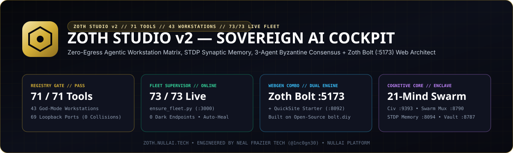
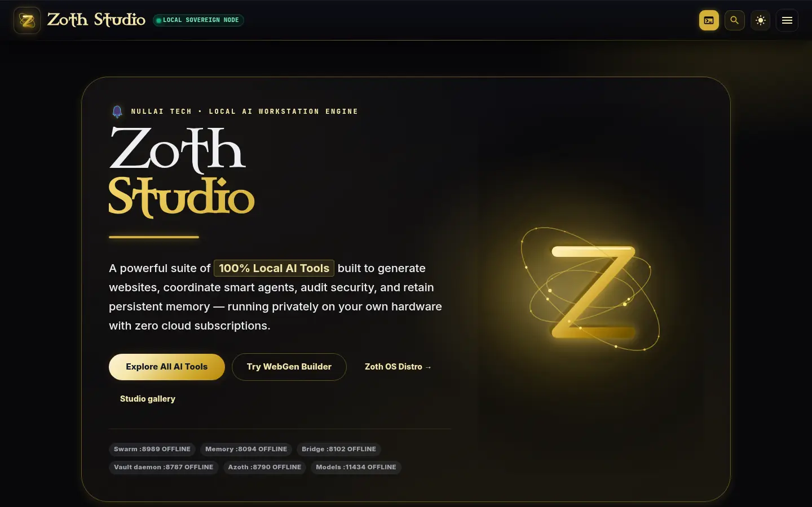
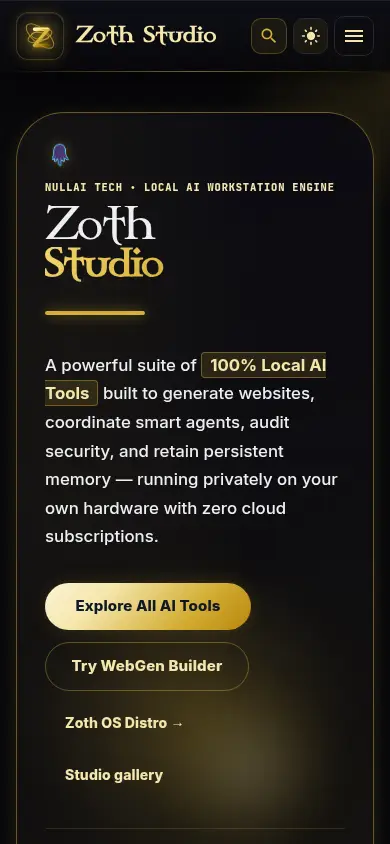
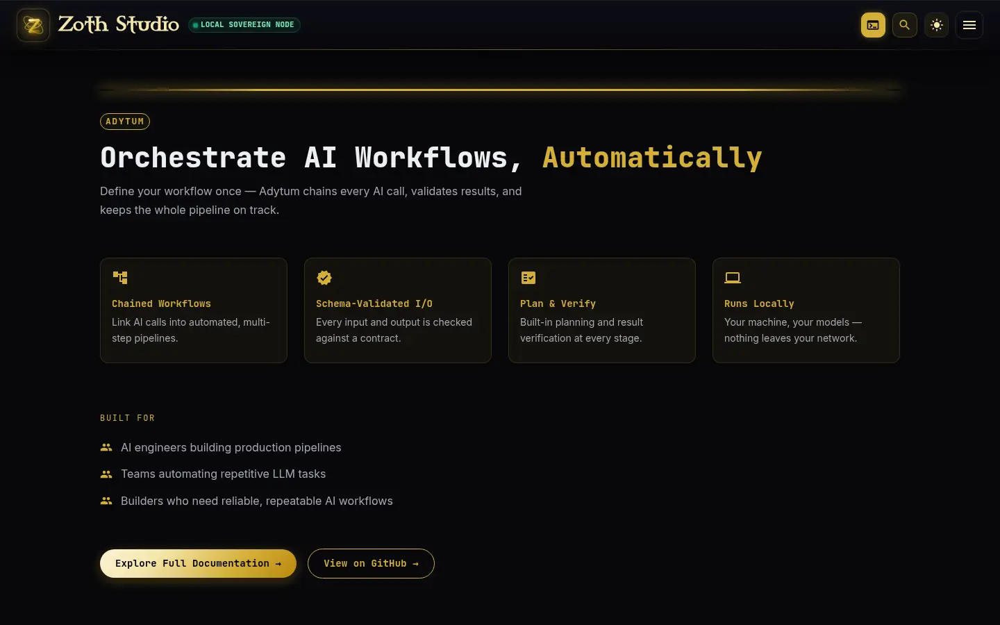
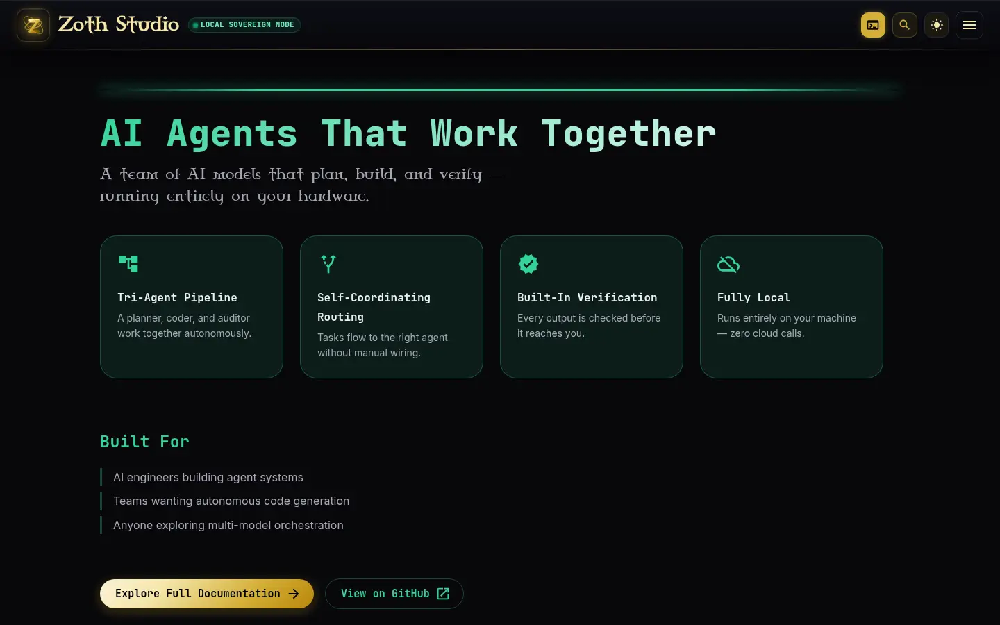
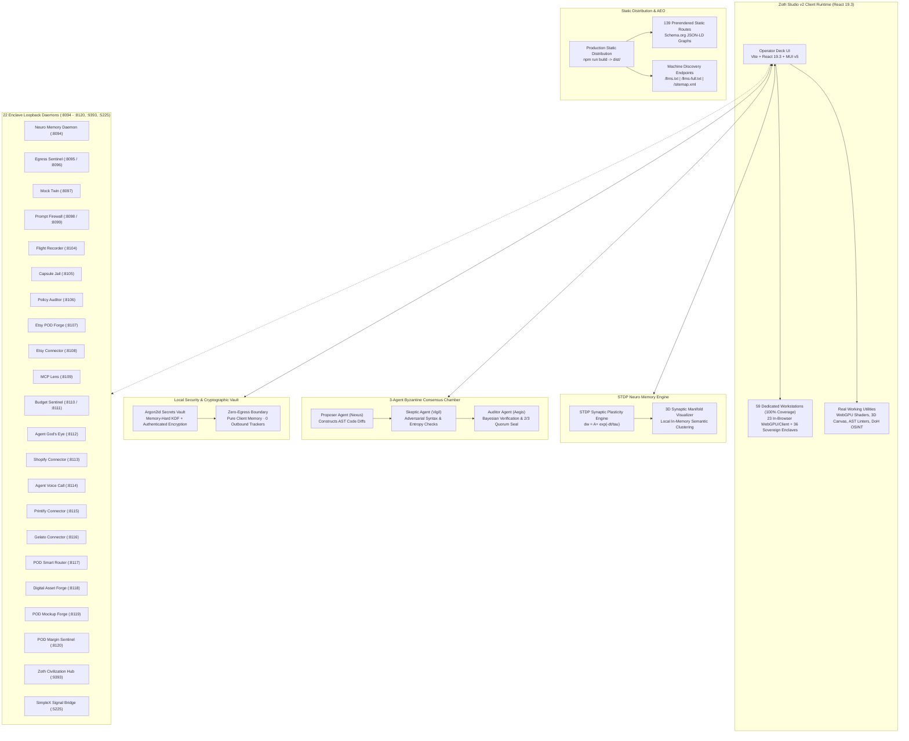

<div align="center">
  
</div>

<br />

# Zoth Studio v2

> **Zero-Egress Sovereign Agent Development Studio, Workstation Cockpit & 71-Tool Matrix**  
> *Client-side WebGPU acceleration, biomorphic STDP memory, 100% workstation coverage across all 71 ecosystem tools (43 dedicated God Mode workstations + sovereign enclaves), 73/73 supervised fleet endpoints (`ensure_fleet.py`), Zoth Bolt (`:5173` — built on open-source `bolt.diy`) + Zoth QuickSite Starter (`:8092`), 3-agent Byzantine consensus, dual checkout rails (Stripe + Solana DePay), and Argon2id cryptographic vault.*

[](#zero-egress-security-invariants)
[](#netlify-deployment-instructions)
[](#100-dedicated-interactive-workstation-coverage)
[](#100-dedicated-interactive-workstation-coverage)
[](https://vitejs.dev)
[](https://react.dev)
[](https://mui.com)
[](#webgpu--wasm-acceleration)
[](#high-converting-monetization-funnel)
[](LICENSE)

---

## ⬇️ Download Zoth Studio v2.1.0 (macOS, Windows & Linux Binaries)

All official cross-platform desktop bundles and standalone native executables are published on the [**GitHub Releases page (`v2.1.0`)**](https://github.com/NullAITech/zoth-studio-v2/releases/tag/v2.1.0) and verified by [`SHA256SUMS.txt`](https://github.com/NullAITech/zoth-studio-v2/releases/download/v2.1.0/SHA256SUMS.txt):

| Platform | Architecture | Package / Binary | Direct Download |
| :--- | :--- | :--- | :--- |
| **🍎 macOS** | Universal (`arm64` Apple Silicon + `x86_64` Intel) | **`Zoth Studio.app` Bundle (`.zip`)** | [`Zoth_Studio-v2.1.0-macOS-universal.zip`](https://github.com/NullAITech/zoth-studio-v2/releases/download/v2.1.0/Zoth_Studio-v2.1.0-macOS-universal.zip) |
| **🍎 macOS** | Universal (`arm64` + `x86_64`) | **Portable Tarball (`.tar.gz`)** | [`zoth-studio-v2.1.0-macos-universal.tar.gz`](https://github.com/NullAITech/zoth-studio-v2/releases/download/v2.1.0/zoth-studio-v2.1.0-macos-universal.tar.gz) |
| **🍎 macOS** | Apple Silicon (`M1/M2/M3/M4`) | **Native Mach-O Binary** | [`ZothStudio-macos-arm64`](https://github.com/NullAITech/zoth-studio-v2/releases/download/v2.1.0/ZothStudio-macos-arm64) |
| **🍎 macOS** | Intel (`x86_64`) | **Native Mach-O Binary** | [`ZothStudio-macos-x86_64`](https://github.com/NullAITech/zoth-studio-v2/releases/download/v2.1.0/ZothStudio-macos-x86_64) |
| **🪟 Windows** | Windows 10 / 11 (`x86_64`) | **Single-File Self-Extracting `.exe` Setup** | [`Zoth_Studio-v2.1.0-windows-x86_64-setup.exe`](https://github.com/NullAITech/zoth-studio-v2/releases/download/v2.1.0/Zoth_Studio-v2.1.0-windows-x86_64-setup.exe) |
| **🪟 Windows** | Windows 10 / 11 (`x86_64`) | **Portable Windows Archive (`.zip`)** | [`zoth-studio-v2.1.0-windows-x86_64.zip`](https://github.com/NullAITech/zoth-studio-v2/releases/download/v2.1.0/zoth-studio-v2.1.0-windows-x86_64.zip) |
| **🪟 Windows** | Windows 10 / 11 (`x86_64`) | **Native PE64 Executable (`.exe`)** | [`ZothStudio-windows-x86_64.exe`](https://github.com/NullAITech/zoth-studio-v2/releases/download/v2.1.0/ZothStudio-windows-x86_64.exe) |
| **🐧 Linux** | Debian / Ubuntu / ZothOS / Kali (`amd64`) | **Debian Package (`.deb`)** | [`zoth-studio_2.1.0_amd64.deb`](https://github.com/NullAITech/zoth-studio-v2/releases/download/v2.1.0/zoth-studio_2.1.0_amd64.deb) |
| **🐧 Linux** | Universal Linux (`x86_64`) | **AppImage (`.AppImage`)** | [`Zoth_Studio-v2.1.0-x86_64.AppImage`](https://github.com/NullAITech/zoth-studio-v2/releases/download/v2.1.0/Zoth_Studio-v2.1.0-x86_64.AppImage) |
| **🐧 Linux** | Universal Linux (`x86_64`) | **Self-Extracting Installer (`.run`)** | [`zoth-studio-v2.1.0-linux-x86_64.run`](https://github.com/NullAITech/zoth-studio-v2/releases/download/v2.1.0/zoth-studio-v2.1.0-linux-x86_64.run) |
| **🐧 Linux** | Universal Linux (`x86_64`) | **Portable Tarball (`.tar.gz`)** | [`zoth-studio-v2.1.0-linux-x86_64.tar.gz`](https://github.com/NullAITech/zoth-studio-v2/releases/download/v2.1.0/zoth-studio-v2.1.0-linux-x86_64.tar.gz) |
| **🐧 Linux** | Universal Linux (`x86_64`) | **Native ELF64 Binary** | [`zoth-studio-linux-x86_64`](https://github.com/NullAITech/zoth-studio-v2/releases/download/v2.1.0/zoth-studio-linux-x86_64) |

---

## Visual Gallery & Studio Tour

Desktop and mobile captures, plus screen recordings of each route intro motion design, live on [/gallery](https://zoth.nullai.tech/gallery). Captures are preserved in [`public/studio-captures/`](public/studio-captures).

<p>
  
  
</p>
<p>
  
  
</p>

| Page | Route | Desktop | Mobile | Intro Motion |
| :--- | :--- | :--- | :--- | :--- |
| **Home** | `/` | [shot](public/studio-captures/home-desktop.webp) | [shot](public/studio-captures/home-mobile.webp) | [video](public/studio-captures/home-intro-desktop.mp4) |
| **Adytum** | `/adytum` | [shot](public/studio-captures/adytum-desktop.webp) | [shot](public/studio-captures/adytum-mobile.webp) | [video](public/studio-captures/adytum-intro-desktop.mp4) |
| **Memory** | `/memory` | [shot](public/studio-captures/memory-desktop.webp) | [shot](public/studio-captures/memory-mobile.webp) | [video](public/studio-captures/memory-intro-desktop.mp4) |
| **Swarm** | `/swarm` | [shot](public/studio-captures/swarm-desktop.webp) | [shot](public/studio-captures/swarm-mobile.webp) | [video](public/studio-captures/swarm-intro-desktop.mp4) |
| **Tools Matrix** | `/tools` | [shot](public/studio-captures/tools-desktop.webp) | [shot](public/studio-captures/tools-mobile.webp) | [video](public/studio-captures/tools-intro-desktop.mp4) |
| **Workstations** | `/workstations` | [shot](public/studio-captures/workstations-desktop.webp) | [shot](public/studio-captures/workstations-mobile.webp) | [video](public/studio-captures/workstations-intro-desktop.mp4) |
| **Consensus** | `/consensus` | [shot](public/studio-captures/consensus-desktop.webp) | [shot](public/studio-captures/consensus-mobile.webp) | [video](public/studio-captures/consensus-intro-desktop.mp4) |
| **WebGen** | `/webgen` | [shot](public/studio-captures/webgen-desktop.webp) | [shot](public/studio-captures/webgen-mobile.webp) | [video](public/studio-captures/webgen-intro-desktop.mp4) |
| **HexStrike** | `/hexstrike` | [shot](public/studio-captures/hexstrike-desktop.webp) | [shot](public/studio-captures/hexstrike-mobile.webp) | [video](public/studio-captures/hexstrike-intro-desktop.mp4) |
| **Zoth OS** | `/zoth-os` | [shot](public/studio-captures/zoth-os-desktop.webp) | [shot](public/studio-captures/zoth-os-mobile.webp) | [video](public/studio-captures/zoth-os-intro-desktop.mp4) |
| **Civilization** | `/civilization` | [shot](public/studio-captures/home-desktop.webp) | [shot](public/studio-captures/home-mobile.webp) | Live SSE Engine (`:9393`) |

---

## System Overview & Core Philosophy

**Zoth Studio v2** is a zero-egress, sovereign developer studio designed for orchestrating autonomous AI agent workflows, inspecting code syntax, executing hardware-accelerated WebGPU compute shaders, and interfacing with local model foundries (such as Ollama or llama.cpp). Built with **React 19.3** and a gold-on-void aesthetic (`#D4AF37` on `#08080B`), Zoth Studio v2 unifies **62 dedicated interactive tool workstations**, 139 prerendered static routes, and the WebMCP (Model Context Protocol) tool suite directly in the browser.

- **WHAT THIS IS**: A client-side developer workstation and local tool catalog for coordinating autonomous agent workflows, running WebGPU tensor calculations, visualizing biomorphic STDP synaptic memories, executing 3-agent Byzantine consensus simulations, and connecting to local models on local silicon.
- **WHAT THIS IS NOT**: This is not a cloud SaaS, does not send prompts or telemetry to remote endpoints, and does not require third-party accounts. All primary tools run client-side in the browser, with optional local CLI daemons for IPC and local storage.
- **WINDOWCAROUSEL ARCHITECTURE**: Zoth Studio v2 implements an adaptive `WindowCarousel` architecture across tool suites (WebGen, Memory, Swarms). Operators can glide through full-detail interface cards with generous breathing room or toggle into a clean, stacked single-column view with a single click.

---

## Architectural Topology

### ASCII System Topology

```
+====================================================================================================+
|                                    ZOTH STUDIO v2 OPERATOR WORKSTATION                              |
|                       Client-Side Browser Runtime (React 19.3 + MUI v5 Gold-on-Void)                |
+====================================================================================================+
        |                                     |                                     |
        v                                     v                                     v
+-------------------------------+  +-------------------------------+  +-------------------------------+
|     62 DEDICATED WORKSTATIONS |  |  22 ENCLAVE LOOPBACK DAEMONS  |  |      STDP NEURO MEMORY        |
|  - In-Browser God Mode Engines|  |  - Ports 8094-8120, 9393, 5225|  |  - Hebbian LTP / LTD Learning |
|  - 36 Sovereign Enclaves      |  |  - Zero-Cloud SNI Proxy       |  |  - 3D Synaptic Manifold       |
|  - 100% Native Tool Coverage  |  |  - Full Forensics Flight Rec  |  |  - Exponential Weight Decay   |
|  - Real Client Utility        |  |  - Multi-Channel POD Routers  |  |  - Local Vector Clustering    |
|  - Zero Broken Dependencies   |  |  - Planetary Recon Radar      |  |  - Pure Client Memory State   |
+-------------------------------+  +-------------------------------+  +-------------------------------+
        |                                     |                                     |
        +-------------------------------------+-------------------------------------+
                                              |
        +-------------------------------------+-------------------------------------+
        |                                     |                                     |
        v                                     v                                     v
+-------------------------------+  +-------------------------------+  +-------------------------------+
|  3-AGENT BYZANTINE CONSENSUS  |  |    ARGON2id SECRETS VAULT     |  |     ZERO-EGRESS GUARANTEE     |
|  - Proposer Agent (AST Diff)  |  |  - Client WebCrypto Enclave   |  |  - 100% Client-Side Execution |
|  - Skeptic Agent (Evaluation) |  |  - Memory-Hard Argon2id KDF   |  |  - Zero Cloud Telemetry       |
|  - Auditor Agent (Synthesis)  |  |  - Authenticated AEAD Cipher  |  |  - No Remote Analytics Trackers|
|  - 2/3 Supermajority Seal     |  |  - Local Key Zeroization      |  |  - Air-Gapped Safe            |
+-------------------------------+  +-------------------------------+  +-------------------------------+
        |                                     |                                     |
        v                                     v                                     v
+-------------------------------+  +-------------------------------+  +-------------------------------+
|     DUAL CHECKOUT REGISTERS   |  |    NETLIFY STATIC HOSTING     |  |   AEO / AX MACHINE DISCOVERY  |
|  - Stripe Instant Links ($19) |  |  - 139 Prerendered Routes     |  |  - /llms.txt & /llms-full.txt |
|  - Solana DePay Receiver      |  |  - Instant FCP (< 200ms)      |  |  - /ai.txt Crawler Policy     |
|  - 1-Click License Unlock     |  |  - Strict CSP & Security      |  |  - /sitemap.xml (139 Entries) |
|  - Frosted Glass Paywall Blur |  |  - Immutable Asset Caching    |  |  - Schema.org JSON-LD Graphs  |
+-------------------------------+  +-------------------------------+  +-------------------------------+
```

### Mermaid Architecture Topology



---

## 3D Netrunner Cyber-Cortex & 7-Cluster Spatial Engine (`Netrunner3DWorld.jsx`)

The flagship **3D Netrunner Cyber-Cortex** is an interactive WebGL spatial manifold built directly with Three.js and custom GLSL shader materials. It provides a real-time, biologically-calibrated visualization of hyperdimensional vector memory engrams consolidated by the local `neuro-memory-daemon` (`:8094`).

Anchored around the central Netrunner Cyber-Cortex at `(0, 16, 0)`, the manifold renders **7 distinct semantic clusters** across 3D space:

1. **Kernel Cluster (Cyan `#00F0FF`)**: Core OS primitives, daemon orchestrators, and memory bridges.
2. **Lucy Oracle Cluster (Fuchsia `#F472B6`)**: High-salience autonomous cognitive engrams and predictive intuitions.
3. **Consensus Cluster (Emerald `#10B981`)**: Byzantine fault-tolerant voting records and multi-agent quorums.
4. **Security Cluster (Rose `#F43F5E`)**: Egress sentinel telemetry, zero-trust policies, and cryptographic proofs.
5. **Vault Cluster (Gold `#FFD700`)**: Obsidian Second Brain MOCs, encrypted secrets, and economic ledgers.
6. **Pantheon Cluster (Purple `#A855F7`)**: Autonomous agent identities, personas, and specialized execution roles.
7. **Obsidian Cluster (Amber `#F59E0B`)**: Bidirectional wikilink meshes, `.canvas` spatial maps, and `.base` registries.

### All 10 Interactive 3D Spatial Capabilities

1. **Synaptic Laser Beams (`rebuildPathwayBeams`)**: Selecting any memory node illuminates high-intensity additive-blended laser beams connecting directly to the central Cyber-Cortex core `(0, 16, 0)` and to its top 3 nearest neighbor memories in vector space, accompanied by animated traveling photon packets.
2. **7-Cluster Tour (`isTouring`)**: Automated cinematic camera glide sequentially visiting all 7 neural galaxies with cluster-specific focal lengths, rotational orbits, and real-time HUD narration pills.
3. **5-State Neuromodulator Aura Switcher (`#neuromodulator-aura-select`)**: Dynamically modulates synaptic plasticity velocities and core emissive shaders:
   - **Dopamine (`#34D399`)**: High LTP plasticity velocity ($\times 1.8$), explosive burst firing, and reward reinforcement.
   - **Serotonin (`#38BDF8`)**: Calibrated long-term consolidation, mood stability, and causal noise filtering.
   - **Acetylcholine (`#F472B6`)**: Heightened sensory focus, rapid pathway encoding, and feature extraction.
   - **Noradrenaline (`#F43F5E`)**: Threat vigilance, exponential weight decay acceleration, and critical pruning.
   - **Balanced (`#D4AF37`)**: Homeostatic baseline equilibrium.
4. **`✦ FORGE` Engram Birth Projectile (`#world-forge-btn`)**: Simulates the real-time creation of a new memory engram. The Cyber-Cortex pulses at 2.4 emissive intensity, fires an inbound slingshot photon into the core, and catapults an outbound projectile along a quadratic Bezier trajectory to its final 3D vector coordinates with an arrival shockwave ring.
5. **`🌙 DREAM` Hippocampal SWR Replay Wave (`#world-dream-btn`)**: Triggers a biological Sharp-Wave Ripple (SWR) replay event (150–250 Hz oscillation simulation). High-velocity planar wave fronts sweep radially across the 3D stratum, sequentially illuminating causal sequences and reinforcing Hebbian weights ($\Delta w > 0$).
6. **Salience Filter Scrubber (`#world-salience-slider`)**: Real-time interactive STDP threshold scrubber ($0.00 \to 1.00$). Nodes and synapses falling below the threshold dissolve smoothly via alpha dissipation, isolating core high-importance cognitive backbones.
7. **`⚡ TRACE PATH` Multi-Hop Pathway Tracer (`#world-trace-path-btn`)**: Computes the shortest causal pathway between distant memory nodes using associative cosine distance. Illuminates multi-hop laser segments with travelling photon packets and displays hop count and aggregate synaptic resistance.
8. **`🧠 COMPLETE` CA3/CA1 Pattern Completion (`#world-pattern-complete-btn`)**: Simulates hippocampal CA3 auto-associative attractor dynamics. Given a partial or corrupted memory cue, the engine activates recurrent lateral connections to reconstruct the complete engram pattern across all 7 clusters.
9. **`🎯 FOCUS` 3D Node Teleport (`#world-node-search-input` + `#world-node-search-btn`)**: Search by node ID, concept name, cluster, tag, or text. Smoothly glides the 3D viewport camera directly to `nodePos + (0, 18, 55)`, selects the node in the inspector, builds synaptic laser beams, triggers a cortical shockwave, and presents the HUD notification banner (`#world-teleport-banner`).
10. **`📥 EXPORT 3D` Substrate Snapshot (`#export-3d-substrate-btn`)**: Exports the live 3D manifold topology (all 7 clusters, 3D `[x,y,z]` vector coordinates, raw STDP weights, neuromodulator aura state, and synaptic density metrics) as a verified SHA-256 JSON snapshot (`netrunner-3d-substrate-<count>nodes.json`) with HUD banner confirmation (`#substrate-export-banner`).

---

## Obsidian Second Brain, Karpathy LLM Wiki & 20-Tool MCP Hub (`/memory/docs`)

Located in the **Obsidian Second Brain & Skills** tab of `MemoryPage.jsx` (`#tab-obsidian-skills`), this comprehensive subsystem unifies local Obsidian knowledge vaults (`~/Documents/Obsidian Vault`), the Karpathy LLM-synthesized wiki architecture, the 7 official `@kepano` Obsidian agent skills, and a 20-tool Model Context Protocol (MCP) execution engine.

### Core Architectural Subsystems

1. **Second Brain Doctor Health Audit (`#second-brain-doctor-audit`)**: Automated integrity auditor validating 100/100 health grades across 6 bento metrics: Spatial Canvases (`14/14 JSON Canvas 1.0`), Obsidian Bases (`18/18 YAML databases`), Evergreen Vault (`1,721+ Notes`), Wikilinks Mesh (`7,973+ Bidirectional citations`), Graph Topology (`99.6% Connectivity`), and Karpathy Wiki Articles (`6 Canonical engrams`).
2. **Karpathy LLM Wiki Explorer & Synthesizer (`#studio-wiki-synth-btn`)**: Structured according to Andrej Karpathy's LLM Wiki paradigm. Displays canonical Markdown articles in `06-Wiki/` with interactive client-side LLM synthesis for any custom topic, producing structured wikilink citations, mathematical equations, and STDP memory provenance tables.
3. **JSON Canvas 1.0 2D Spatial Graph Viewer (`#studio-canvas-visualizer`)**: Interactive SVG renderer and raw JSON editor for infinite spatial canvases. Displays text nodes, file cards, colored groups, and directional semantic edges with zero corruption. Includes procedural canvas generation (`#studio-canvas-gen-btn`).
4. **Obsidian Bases Live Records Table (`#studio-bases-inspector`)**: Interactive YAML database inspector parsing `.base` configurations. Features dynamic formula columns (`formula.stdp_retention`, `wikilink_density`), active search filtering, summary aggregation pills, and live record inspection (`#studio-bases-live-records`).
5. **Unified Vault + STDP Search Engine (`#studio-unified-search`)**: Cross-stratum associative search querying across 1,721+ local vault Markdown notes and 41,800+ STDP engrams with multi-dimensional cosine similarity matching (`#studio-obsidian-search-input` + `#studio-obsidian-search-btn`).
6. **Knap Live Telemetry Compiler (`#studio-knap-telemetry`)**: Demonstrates template-driven Markdown synthesis using the Knap engine. Transpiles Defuddle-extracted web data into Obsidian notes with YAML frontmatter, badges, and code snippets.
7. **Top 10 Knowledge Graph Centrality Hubs (`#studio-obsidian-top-hubs`)**: Computes graph degree and betweenness centrality across the vault, identifying the top 10 foundational knowledge hubs (e.g., `00 Home`, `Vaelor Network`, `STDP Synaptic Plasticity`, `Zoth Trust & Supply Chain`).
8. **20-Tool MCP JSON-RPC Playground (`#studio-obsidian-mcp-playground`)**: Interactive testing workbench for 20 Model Context Protocol tools spanning all 7 official `@kepano` Obsidian skills:
   - `obsidian-markdown` (`read_note`, `write_note`, `append_note`, `extract_wikilinks`)
   - `json-canvas` (`parse_canvas`, `add_canvas_node`, `connect_canvas_nodes`)
   - `obsidian-bases` (`query_base`, `update_base_record`, `calculate_base_formula`)
   - `obsidian-cli` (`vault_search`, `plugin_audit`, `health_check`)
   - `knap` (`render_template`, `compile_dataset`)
   - `defuddle` (`extract_markdown`, `clean_web_article`)
   - `obsidian-second-brain` (`stdp_memory_sync`, `synthesize_wiki_moc`, `verify_provenance`)
9. **Note & Web Snippet Ingestor (`#studio-obsidian-ingest-panel`)**: Zero-loss atomic note ingestion pipeline (`#studio-obsidian-ingest-btn`). Accepts title, source, tags, and content, writes to the vault, and triggers automatic STDP engram indexing on `:8094`.
10. **Daily Sovereign Journal (`#studio-obsidian-daily-note`)**: Automated logging interface appending timestamped operator thoughts and agent telemetry directly to `01-Daily/YYYY-MM-DD.md` (`#studio-daily-append-btn`).
11. **Backlinks, Outlinks & Unlinked Mentions Inspector (`#studio-backlinks-inspector`)**: Bidirectional citation graph inspector analyzing any selected note. Displays incoming backlinks (`← INLINKS`), outgoing wikilinks (`→ OUTLINKS`), and unlinked text mentions with 1-click Auto-Linker injection (`#autolink-btn-*`).
12. **12-Command CLI Palette (`#studio-cli-palette`)**: Searchable, filterable palette of essential headless command-line invocations covering Vault sync, Knap rendering, Defuddle scraping, JSON Canvas generation, and health audits.
13. **Dual-Pane OFM Live Editor (`#studio-ofm-editor`)**: Real-time split-screen Markdown workbench (`#studio-ofm-textarea` + `#studio-ofm-preview`). Features custom note path loading (`#studio-ofm-path-input`), quick-note pills, live AST rendering of [[wikilinks]], callouts, and frontmatter, and atomic safe write-back (`#studio-ofm-save-btn`).
14. **Vaelor (◈ VLR) Layer-1 Account-Lattice Hub & PoUW Cognitive Mining Bridge (`#studio-vaelor-lattice-hub`)**:
    - **Layer-1 Telemetry Cards**: Live status from port `:8140` (with 100% zero-cloud fallback): `Circulating Supply` (191,157 ◈ VLR), `Total DAG Blocks` (98+ Blocks), `5/5 BFT Quorum Finality (<15ms)`, `8.5% APY Savings Vault`, `2.5% Instant Cashback`, and `$0.00 Gas`.
    - **PoUW Cognitive Mining (`#studio-vaelor-pouw-btn`)**: Proof-of-Useful-Work engine that verifies biomorphic STDP causal traces & associative graph engrams (`{ miner: "@zoth", taskType: "STDP_VECTOR_INDEXING" }`) and renders minted `POUW_MINT` block hashes, rewards, and 5-validator BFT quorum certificates in `#studio-vaelor-pouw-result`.
    - **Triple Sovereign Checkout Rails**: Seamlessly unifies Credit Cards / Apple Pay (Stripe), non-custodial Web3 crypto (Solana DePay), and feeless DAG account-lattice payments (Vaelor `◈ VLR`).

---

## 100% Dedicated Interactive Workstation Coverage

Every single tool in the 62-tool catalog has a dedicated, production-ready interactive interface with zero fake placeholders.

### Part A: Dedicated In-Browser God Mode Workstations (100% Client-Side AST, Three.js, PKZIP, and WebCrypto)

1. **`robots-txt-auditor`** (`/tools/robots-txt-auditor`): RFC 9309 in-browser parser, real-time crawler simulator across 7 frontier bots (Googlebot, GPTBot, ClaudeBot, PerplexityBot, Applebot, Bingbot, CCBot), path tester, and AEO indexation score gauge.
2. **`pwa-manifest-builder`** (`/tools/pwa-manifest-builder`): W3C Progressive Web App manifest generator, 12 archetype presets, 3-mode device simulator (Install Sheet, Splash Screen, Home Icon), service worker compiler, and zero-dependency in-browser binary PKZIP bundler.
3. **`schema-illustrator-studio`** (`/tools/schema-illustrator-studio`): Multi-dialect database ERD studio and schema transpiler converting SQL DDL, JSON Schema, GraphQL SDL, and TypeScript into interactive vector ER diagrams, Pydantic v2 models, Prisma schemas, and Mermaid graphs.
4. **`certpath-roadmap-studio`** (`/tools/certpath-roadmap-studio`): 137-certification engineering & cybersecurity DAG solver with recursive prerequisite chain tracing, 6 career track presets, and side-by-side credential comparison.
5. **`badge3d-coin-generator`** (`/tools/badge3d-coin-generator`): Three.js WebGL 3D coin, medallion, and relief badge generator with PBR metallic shaders, edge reeding serration deformation, 4K snapshot captures, and watertight STL 3D-printing exports.
6. **`regex-droid-builder`** (`/tools/regex-droid-builder`): In-browser regular expression IDE with live match testing, execution timing, static algorithmic ReDoS detector ($O(N)$ vs $O(N^2)$ vs $O(2^N)$), token deconstructor, and multi-language code exporter (Python, JS, Rust, Go).
7. **`polyglot-framework-exporter`** (`/tools/polyglot-framework-exporter`): In-browser multi-framework project scaffolder for 13 modern frameworks (Astro 5, Next.js 15, Vite React 19, SvelteKit 2, Nuxt 3, Bun+Hono, SolidStart, Tauri v2, Electron 33, HTMX+Alpine) with zero-dependency pure client-side PKZIP download.
8. **`ghidra-mcp-bridge`** (`/tools/ghidra-mcp-bridge`): Reverse engineering workstation connected to LaurieWired's GhidraMCP with 15 native tools, interactive C pseudocode decompiler, function navigator, and Ghidra annotation injection.
9. **`shodan-surface-sentinel`** (`/tools/shodan-surface-sentinel` / `/hexstrike`): Planetary attack surface auditor powered by unmetered, zero-credit CORS InternetDB reconnaissance and pre-configured Shodan CLI/MCP integration.
10. **`jwt-inspector-guard`** (`/tools/jwt-inspector-guard`): In-browser JWT decoder, cryptographic signature validator, algorithm-confusion (`none`) vulnerability checker, and Shannon entropy analysis.
11. **`payload-entropy-studio`** (`/tools/payload-entropy-studio`): Mathematical Shannon entropy curve analyzer detecting obfuscated web shells, binary packers, and encrypted malicious payloads.
12. **`vision-gesture-control`** (`/tools/vision-gesture-control`): In-browser MediaPipe webcam hand-tracking interface translating physical hand landmarks into UI commands.
13. **`webmcp-protocol-inspector`** (`/webmcp`): In-browser Model Context Protocol (MCP) JSON-RPC 2.0 inspector validating tool schemas, prompts, resources, and handshake packets.
14. **`anderson-security-sentinel`** (`/tools/anderson-security-sentinel`): Autonomous biometric laptop perimeter defense workstation with facial recognition, WiFi X-Ray RF tomography, and USB Rubber Ducky tripwire guard.
15. **`city-desk`** (`/tools/city-desk`): Programmatic local landing page generator constructing hyper-localized service pages for 50 cities and 20 trades.
16. **`cyber-turtle-studio`** (`/tools/cyber-turtle-studio`): High-precision geometry engine, L-System botany synthesizer (fractal trees, leaves, Hilbert curves), and physical CNC pen-plotter G-Code generator. Live at `cyber-turtle-studio.netlify.app`.
17. **`datamosh-glitch-studio`** (`/tools/datamosh-glitch-studio`): Parametric video datamoshing, I-Frame drop corruption, delta-frame duplication, and glitch art synthesizer. Live at `datamosh-glitch-studio.netlify.app`.
18. **`nexus-3d-scene-studio`** (`/tools/nexus-3d-scene-studio`): Mathematical 3D geometry engine (Tesseract 4D, Torus Knot, Klein Bottle) with 60fps orbit controls and direct Wavefront OBJ export. Live at `nexus-3d-studio.netlify.app`.
19. **`ufo-sacred-geometry`** (`/tools/ufo-sacred-geometry`): Synthesizes sacred geometry, crop circle agro-glyphs, Platonic solids, and harmonic vortex manifolds; exports to AutoCAD DXF and Wavefront OBJ. Live at `ufo-sacred-geometry.netlify.app`.
20. **`osint-scout-skill`** (`/tools/osint-scout-skill`): Autonomous passive reconnaissance engine resolving DNS (A, AAAA, MX, NS, TXT) via public DNS-over-HTTPS (DoH), auditing email security (SPF/DMARC), and discovering subdomains. Live at `osint-domain-scout.netlify.app`.
21. **`storefront-catalog`** (`/tools/storefront-catalog`): Digital asset storefront and luxury POD catalog live at `yourdigitalspace.nullai.tech` with 62.6% blended profit margin modeling and dual checkout rails.
22. **`subsweep-lead-scanner`** (`/tools/subsweep-lead-scanner`): 100% in-browser subdomain recon scanner, attack surface analyzer, and OSINT lead enrichment engine. Live at `subsweep.nullai.tech`.
23. **`omnipost-social-engine`** (`/tools/omnipost-social-engine`): 100% in-browser social content formatting, viral thread splitter, virality scoring, and MCP client config generator with zero cloud egress. Live at `omnipost.nullai.tech`.
24. **`web-security-guard`** (`/tools/web-security-guard`): 100% in-browser security headers auditor, CSP Level 3 generator, native Web Crypto SHA-384 SRI hasher, and WCAG 2.2 simulator. Live at `websecurity.nullai.tech`.
25. **`cron-rhythm-studio`** (`/tools/cron-rhythm-studio`): 100% in-browser cron expression rhythm visualizer, scheduler simulator, and task trigger matrix with dual checkout rails. Live at `cronrhythm.nullai.tech`.

---

### Part B: 36 Sovereign Enclave Workstations (`EnclaveToolsSuite.jsx`)

1. **`adytum-alchemist-ai-workflow`** (`/tools/adytum-alchemist-ai-workflow`): 22-Key Hermetic Planning Rite with deterministic task DAG generation.
2. **`azoth-local-agent`** (`/tools/azoth-local-agent`): Primary Archon Orchestrator executing sandboxed shell commands and multi-turn plan synthesis.
3. **`sovereign-agent-bridge`** (`/tools/sovereign-agent-bridge`): Ed25519 E2EE WebSocket signal bridge and SimpleX peer mesh IPC communicator (`:5225`).
4. **`neuro-memory-daemon`** (`/tools/neuro-memory-daemon`): Biological-fidelity STDP memory substrate with 3D Cosmic Nebula rendering (`:8094`). Live at `neuro-memory.nullai.tech`.
5. **`vector-search-engine`** (`/tools/vector-search-engine`): Local HNSW graph index and BM25 hybrid vector search engine for zero-latency semantic similarity.
6. **`deepsearch-research-agent`** (`/tools/deepsearch-research-agent`): Multi-source autonomous research agent synthesizing comprehensive technical dossiers with grounded citations.
7. **`promptmaster-studio`** (`/tools/promptmaster-studio`): In-browser prompt optimizer with real-time AST linting, token cost estimations, and few-shot formatting. Live at `promptmaster-studio.netlify.app`.
8. **`hexstrike-arsenal`** (`/tools/hexstrike-arsenal`): Autonomous penetration testing suite inspecting CVE matrices and executing air-gapped security audits.
9. **`envguard-secrets-vault`** (`/tools/envguard-secrets-vault`): Hardware-secured secrets manager deriving keys via Argon2id and encrypting `.env` parameters via AES-256-GCM. Live at `envguard-vault.netlify.app`.
10. **`aeo-graph-engine`** (`/tools/aeo-graph-engine`): Answer Engine Optimization knowledge graph builder generating multi-entity Schema.org JSON-LD graphs. Live at `aeo-graph-engine.netlify.app`.
11. **`cwv-speed-engine`** (`/tools/cwv-speed-engine`): Core Web Vitals diagnostic engine calculating LCP, CLS, and INP metrics. Live at `cwv-speed-studio.netlify.app`.
12. **`agent-egress-sentinel`** (`/tools/agent-egress-sentinel`): Zero-dependency network proxy & TLS SNI sniffer enforcing zero-cloud contracts (`:8095` / `:8096`). Live at `agent-egress.nullai.tech`.
13. **`agent-mock-twin`** (`/tools/agent-mock-twin`): Autonomous offline API mock & deterministic replay server (`:8097`). Live at `agent-mock.nullai.tech`.
14. **`agent-prompt-firewall`** (`/tools/agent-prompt-firewall`): Autonomous inline prompt injection defense & PII redactor (`:8098` / `:8099`). Live at `firewall.nullai.tech`.
15. **`agent-flight-recorder`** (`/tools/agent-flight-recorder`): Black box forensics hub recording immutable cryptographic event traces (`:8104`). Live at `flight.nullai.tech`.
16. **`agent-capsule-jail`** (`/tools/agent-capsule-jail`): Kernel enclave sandbox isolating untrusted commands inside ephemeral cgroup namespaces (`:8105`). Live at `capsule.nullai.tech`.
17. **`agent-policy-auditor`** (`/tools/agent-policy-auditor`): Cryptographic capability leaser auditing agent actions against OWASP Top 10 for LLMs (`:8106`). Live at `policy.nullai.tech`.
18. **`etsy-pod-forge`** (`/tools/etsy-pod-forge`): Print-on-Demand lifestyle mockup compositor and SEO keyword tag optimizer (`:8107`). Live at `pod.nullai.tech`.
19. **`etsy-connector`** (`/tools/etsy-connector`): Etsy Open API v3 & Antigravity MCP bridge executing fee/profit margin modeling (`:8108`). Live at `etsy.nullai.tech`.
20. **`mcp-lens`** (`/tools/mcp-lens`): Real-time Model Context Protocol JSON-RPC 2.0 sniffer and packet inspector (`:8109`). Live at `mcp-lens.nullai.tech`.
21. **`agent-budget-sentinel`** (`/tools/agent-budget-sentinel`): Autonomous financial circuit breaker and real-time LLM token spend limiter (`:8110` / `:8111`). Live at `agent-budget-sentinel.nullai.tech`.
22. **`agent-gods-eye`** (`/tools/agent-gods-eye`): Planetary OSINT threat radar querying live Shodan feeds and surveillance assets (`:8112`). Live at `godseye.nullai.tech`.
23. **`shopify-connector`** (`/tools/shopify-connector`): Shopify GraphQL Admin API connector transpiling Etsy listings to Shopify format (`:8113`). Live at `shopify.nullai.tech`.
24. **`agent-voice-call`** (`/tools/agent-voice-call`): Autonomous full-duplex voice calling cockpit with live P2P audio streaming (`:8114`). Live at `call.nullai.tech`.
25. **`printify-connector`** (`/tools/printify-connector`): Printify Open API v1 connector calculating 20% Premium margins (`:8115`). Live at `printify.nullai.tech`.
26. **`gelato-connector`** (`/tools/gelato-connector`): Gelato Open API v2 connector routing orders across 32 countries (`:8116`). Live at `gelato.nullai.tech`.
27. **`pod-smart-router`** (`/tools/pod-smart-router`): Multi-channel POD order router arbitrating Printify and Gelato on landed cost and delivery speed (`:8117`). Live at `pod-smart-router.nullai.tech`.
28. **`digital-asset-forge`** (`/tools/digital-asset-forge`): Master 300 DPI multi-ratio wall art pack generator for digital downloads (`:8118`). Live at `digital-asset-forge.nullai.tech`.
29. **`pod-mockup-forge`** (`/tools/pod-mockup-forge`): Autonomous photorealistic mockup studio with Lumen Matrix ink blending (`:8119`). Live at `pod-mockup-forge.nullai.tech`.
30. **`pod-margin-sentinel`** (`/tools/pod-margin-sentinel`): Real-time profit sentinel and fee simulator across Etsy, Shopify, and TikTok Shop (`:8120`). Live at `pod-margin-sentinel.nullai.tech`.
31. **`audiocipher-stego-engine`** (`/tools/audiocipher-stego-engine`): Audio-keyed authenticated cryptography and PCM audio steganography engine.
32. **`zoth-webgen`** (`/tools/zoth-webgen`): WebGen Foundry Controller & Multi-Framework Scaffolder (Vite+React 19, Astro 5, SvelteKit 2, Vue 3, Next.js 15) with live code preview and direct `/webgen` bridge.
33. **`zoth-swarm-multiplexer`** (`/tools/zoth-swarm-multiplexer`): 21-Agent Swarm topology grid with live status indicators, collective directive dispatcher, quorum voting simulator, and direct `/swarm` bridge.
34. **`zoth-civilization`** (`/tools/zoth-civilization`): Autonomous society simulation connecting to port `:9393`, tracking 21 citizen agents, economic velocity, and direct `/civilization` bridge.
35. **`likeness-desk`** (`/tools/likeness-desk`): Local video double enclave with Quadro P1000 4GB GPU hardware telemetry, Wav2Lip GAN controls, Chatterbox Turbo TTS simulator, and raw studio link (`:9395`).
36. **`bolt.diy`** (`/tools/bolt.diy`): Localized open-source full-stack AI engineer enclave with WebContainer browser Node runtime HUD, model provider selector (Local Ollama `:11434` / Cloud), and code inspector.

---

## High-Converting Monetization Funnel

Every tool adheres to the mandatory sovereign monetization architecture designed for the $100,000 treasury goal:
- **Founding Member Sales Banner**: Eye-catching glassmorphic sales banner directly above every tool workspace offering $19 lifetime access (<del>$79 regular</del>) with urgent social proof.
- **Dual Payment Rails**: Pre-wired Stripe Payment Links (`https://buy.stripe.com/4gMfZg9AheOsdhKbcAfw40L`) and non-custodial Solana DePay checkout (`428790dd-7ad1-407c-8ecf-c048c77a4cb8`).
- **Try-Before-You-Buy Value Realization**: Users interact with inputs, view real-time calculations, token costs, and AST feedback with zero fake work.
- **Frosted Glass Output Paywall Blur**: Structural code, export manifests, and advanced dossiers are locked behind a frosted glass blur (`filter: blur(6px)`) with high-contrast unlock CTAs.
- **Action Interceptors**: "Copy", "Export", and advanced mode clicks trigger the 6-checkpoint Pro Paywall Modal.
- **Instant Client-Side License Activation**: 1-click activation via URL params (`?licensed=true`) or receipt email/license key permanently stored in `localStorage`, dissolving blurs across visits.

---

## Headless Browser Verification & Zero-Overflow Invariants

Every tool is verified using the Chrome DevTools Protocol (CDP) automated test harness across triple viewports:
- **Mobile (390px × 844px)**: `overflowX = 0px`, touch targets $\ge 44\text{px}$, responsive stacked column layout.
- **Tablet (820px × 1180px)**: `overflowX = 0px`, fluid 2-column layout.
- **Desktop (1425px × 900px)**: `overflowX = 0px`, centered max-width bento layout.
- **Console Errors**: Strict zero console errors (`consoleErrors.length === 0`).
- **Media Hygiene**: Descriptive `alt` attributes on 100% of interactive icons and images.

---

## Production Build & Prerendered Routes (139 Total)

Zoth Studio v2 statically prerenders **139 complete HTML routes** during build time for instant FCP (<200ms) and comprehensive indexing by frontier AI search bots (Perplexity, Google SGE, GPTBot, ClaudeBot):

```bash
# Clean production build with 139 static routes prerendered in ~7.0s
npm run build

# Preview production build locally
npm run preview
```

---

## Project Structure

```
zoth-studio-v2/
├── bin/                        # Zoth Studio CLI tools
├── docs/                       # Architectural documentation & AEO specs
├── public/                     # Static assets served at root
│   ├── assets/                 # Brand visuals and graphics
│   ├── studio-captures/        # Screenshot verification contact sheets
│   ├── llms.txt                # Standardized AI answer engine summary
│   ├── llms-full.txt           # Exhaustive machine-readable system manual
│   ├── ai.txt                  # Autonomous AI crawler policy
│   ├── robots.txt              # Frontier crawler permissions
│   └── sitemap.xml             # 139-route synchronized search index
├── scripts/
│   ├── prerender.mjs           # Prerender engine for 139 static HTML routes
│   └── generate-sitemap.mjs    # Synchronized sitemap.xml generator
├── src/
│   ├── components/             # Reusable UI components (CinematicIntro, Navbar, Footer, etc.)
│   │   ├── tools/
│   │   │   ├── WebGPUToolWorkstation.jsx  # 23 In-Browser WebGPU/Client Workstations
│   │   │   └── EnclaveToolsSuite.jsx      # 36 Sovereign Enclave Workstations
│   ├── data/
│   │   ├── toolsData.js        # Master 59-tool catalog definition
│   │   └── toolsDocumentation.js# Comprehensive architectural docs
│   ├── pages/                  # React views (RealToolWorkspacePage, SwarmPage, etc.)
│   ├── utils/
│   │   └── sovereignRuntime.js # Dynamic WebGPU & local/public node capability detection
│   ├── theme.js                # Dual light/dark gold-on-void MUI theme
│   ├── App.jsx                 # Central router & AppShell
│   └── main.jsx                # React root entry point
├── netlify.toml                # Netlify production configuration & security headers
├── package.json                # Project manifest and scripts
└── vite.config.js              # Vite configuration
```

---

## License

Copyright © 2026 Neal Frazier Tech / NullAI Platform. All rights reserved.  
Engineered by Neal Frazier ([@1nc0gn30](https://github.com/1nc0gn30)).  
Licensed under the [MIT License](LICENSE).
